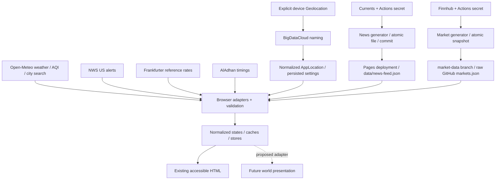

# Current data contracts and integration boundaries

Audited 2026-11-02. Companion documents: [system audit](../specs/01-existing-system-audit.md), [feature inventory](current-feature-inventory.md). This is a record of existing interfaces and limitations, not approval to migrate providers, rewrite fetching, or change public schemas. Source-relative paths below begin at repository root.

## Evidence and preservation rules

Source facts are attributed to modules below. External provider/library facts link to official documentation reviewed on the audit date. Suggested adaptations are explicitly recommendations. Account access, deployed-origin CORS, current provider response health, and production Actions execution were **not tested**. In particular, a passing mocked provider test does not establish that a live endpoint accepts today's parameters.

The stable preservation boundary is normalized feature data, service functions and generated JSON—not provider wire fields inside rendering. Keep credentialed Finnhub/Currents operations in Actions/Node. No new backend, unofficial proxy, browser provider key, GitHub dispatch token, or production mock fallback is needed for Living World.



## 1. Shared interfaces

| Contract / source | Shape and semantics | Reuse assessment |
| --- | --- | --- |
| `features/location/model.ts` — `AppLocation` | `id`, `name`, optional `admin1`, country/name/code, latitude/longitude, IANA timezone string, source `device/search/saved` | Retain for provider context. Schema checks coordinate bounds but not IANA timezone validity. |
| `types/settings.ts` — `AppSettings` | Version 2, location/useCurrentLocation/saved label, temperature/time format, news categories, market visibility/symbols, motion/glass/density/reduced motion, currency pair/enabled, nested Islamic settings, optional dev indicator, demo flag | Preserve persisted schema and migration. New camera/quality/mode preferences require reviewed schema evolution; do not put transient frame state here. |
| `app/refreshCoordinator.ts` — `RefreshProvider` | `id`, enabled predicate, stale predicate, `refresh({force, signal, cause})` → Promise `success/cached/skipped`; cause `initial/routine/visible/online/settings/manual` | Retain orchestration interface outside renderer. Summary aggregates succeeded/cached/failed/skipped, not per-value quality. |
| `lib/api/types.ts` — `AppApiError` | Error code, optional HTTP status/Retry-After/cause. Codes: network/offline/timeout/http/invalid-response/rate-limit/aborted/configuration/unknown | Reusable where active; direct Fetch integrations mostly throw ordinary errors. Do not assume universal error normalization. |
| `lib/api/types.ts` — `RemoteData<T>` | idle/loading, or success `{data,fetchedAt,source:network/cache,freshness:fresh/stale}`, or error `{error,previousData?}` | Active market/shared-client result; `fresh` means fetch/cache freshness, not live provider observation. |
| `types/remote.ts` — `DataFreshness` / `RemoteState<T>` | Vocabulary `live/delayed/end-of-day/cached/stale/unavailable/demo`; separate status union | Vocabulary can guide a projection. This generic RemoteState is not the active common hook contract. Do not claim all domains already implement it. |
| `lib/api/cacheService.ts` | `setCache`, `readCache`, compatibility `getCache`, clearKey/clearAll; policy fresh/stale durations and optional validity key | Retain storage ownership/last-success semantics. Payload runtime validation belongs to domain caller. |
| Compatibility modules | `src/lib/types/index.ts` → `src/types`; `src/lib/stores/*` → canonical stores; prayer service → Islamic implementation | Preserve callers during visual work; not separate sources of truth. |

Examples of existing interface style (from `src/app/refreshCoordinator.ts`):

```ts
export type ProviderRefreshResult = 'success' | 'cached' | 'skipped';
```

This result reports a refresh outcome. It is not sufficient provenance for an individual price, weather condition, or prayer schedule.

## 2. Weather

**Service:** `fetchWeatherData(location, unit = 'fahrenheit', signal?)` → `Promise<WeatherData>` in `src/features/weather/weatherService.ts`, delegating to `fetchOpenMeteoWeather(location, {unit,timeFormat?,signal?})`.

**Provider:** keyless `https://api.open-meteo.com/v1/forecast`; latitude/longitude, `timezone=auto`, two days, current temperature/apparent temperature/humidity/weather code/wind/is_day; hourly temperature/precipitation probability/weather code/UV; daily high/low/sunrise/sunset. Unit settings request Fahrenheit/mph/inch or Celsius/kmh/mm.

**Validation:** `providers/openMeteoSchemas.ts` validates required objects/nonempty series, matching hourly/daily lengths, day flag and numbers. It does not enforce every scientific range or timestamp/IANA semantic. `apiFetch`: 8-second request timeout, two retries beyond initial attempt, transient-only with backoff.

**Normalized contract:** `WeatherData` contains temperature, feelsLike, high/low, condition display string, iconName, humidity, windSpeed/unit, nullable UV, optional deterministic summary, hourly `{time,temp,pop,iconName,isoTime?}`, optional raw sunrise/sunset strings, isDay, timezone. It rounds most values and selects eight future hours using returned UTC offset. Display uses six by default. `CurrentWeatherNormalized` internally includes `observedAt`, numeric weatherCode and effectVariant, but the exported WeatherData **drops** those fields. Sunrise/sunset/hourly strings from Open-Meteo are local times without offsets; interpret with the location timezone, not browser timezone or raw `new Date` assumptions.

**Hook result:** `WeatherState` is loading/loaded/cached/permission_denied/location_unavailable. Cached has data and human-readable lastUpdatedText, not a structured observed timestamp. Cache key rounds lat/lon to two decimals and includes unit; fresh 15 minutes, usable stale additional 24 hours. Fresh cache is initially represented as loaded; the loader still requests network data when invoked. Failure retains usable cache without rewriting timestamps. If none, show unavailable; mock fallback only when DEV demo enabled.

**Reuse:** Current service/model sufficient for the existing HTML and broad environment classification. Recommendation: an adapter can reuse `deriveWeatherEffect`/`deriveTimeOfDay`/`deriveAmbientLightPosition`; do not infer precise rain intensity or observed age from condition text. Richer physical atmosphere/provenance requires explicit metadata extension or an unknown state, not parsing presentation labels into fabricated measurements.

## 3. Air quality

**Provider/function:** `fetchOpenMeteoAirQuality(location, {signal?})` → `AirQualitySnapshot`; keyless `https://air-quality-api.open-meteo.com/v1/air-quality`, current US AQI/PM2.5/PM10/ozone, timezone auto. Uses `apiFetch` 8-second timeout and default one retry.

**Validation/model:** Schemas allow null/absent pollutant values but require at least one requested value. Snapshot `{usAqi:number|null, category, pm25?,pm10?,ozone?, measuredAt:string}`; rounded readings, deterministic category via `aqiInterpreter`. Provider timezone/offset are validated but dropped from snapshot; observed time can lack offset. Guidance is static general guidance, not a personalized safety assessment.

**State/cache:** loading/loaded/cached/unavailable; cached carries lastUpdatedText. Lat/lon rounded to two decimals; fresh 30 minutes plus 24-hour stale allowance. Failure retains usable cache, otherwise unavailable. `null` AQI remains unknown even if pollutants exist. Cached payload itself is not schema-validated on cache read.

**Reuse:** Provider/model/interpretation unchanged for HTML and an adapter. Carry cached/unknown state explicitly; any world fog must not masquerade as a measured current pollutant level.

## 4. Location acquisition and naming

`searchLocations(query,{count?,language?,signal?})` returns `AppLocation[]` from Open-Meteo geocoding search. Queries <2 characters return empty without network. Search defaults count 10/en; actual settings UI asks for 8 after 300 ms. Schema defaults missing country/timezone fields and maps IDs to `om-*`; `apiFetch` 8 seconds, one retry. Selection passes through coordinate-bound location validation before persistence.

`useAppLocation` requests browser position only on a user action: low accuracy, 10-second timeout, maximumAge 5 minutes. Device coordinates go to `reverseGeocodeDeviceLocation` at `https://api.bigdatacloud.net/data/reverse-geocode-client`; keyless, 6-second timeout, no retry; Zod normalization trims city/locality/admin/country. Failed naming retains coordinates and generic name, country code empty. Device timezone comes from browser Intl. Device location is not watched or continuously refreshed.

BigDataCloud's official client endpoint restricts use to current device coordinates obtained through standard platform geolocation, not arbitrary saved/batch/server queries. Existing implementation follows this boundary. Its policy also describes use of the GPS/IP pairing; preferences' local-storage statement is not a complete statement about external provider processing. Preserve explicit consent and explain coordinate transfer. [Official client reverse-geocoding documentation](https://www.bigdatacloud.com/docs/free-api/free-reverse-geocode-to-city-api).

**Reuse:** Search/naming/normalized location can remain. Unknown country suppresses NWS; invalid/mismatched timezone and context changes need explicit scene-neutral handling. No provider credential required.

## 5. NWS alerts

**Function:** `fetchNWSAlerts(latitude,longitude,signal?)` → sorted `WeatherAlert[]`, official `https://api.weather.gov/alerts/active?point=...`, coordinates rounded to four decimals, Accept GeoJSON. Direct Fetch; no local timeout/retry. Hook gates US country code.

**Schema/normalized contract:** `NwsAlertsResponseSchema` validates FeatureCollection/features/properties, allows null/absent provider fields. Normalization yields stable id, event/headline/description/instruction, severity, certainty, urgency, status/message type, area description, effective/onset/expires/ends, sender/source. Filters test/cancel and expired alerts, orders severity then urgency then expiry. Does not attach domain freshness/fetchedAt to each alert.

**Cache/state:** 10-minute fresh plus 24-hour stale; hook initializes from usable cache and filters active/dismissed entries. Dismissals persisted under `ambient_dismissed_nws_alerts_v2`, pruned when read using expiration; no end time can make a dismissal indefinite. Empty array conflates none/unsupported/unavailable in the main UI. After TypeError without fallback, hook disables provider until remount; not every TypeError proves CORS specifically. Provider diagnostics explain failure. Dismiss writes localStorage directly, unlike fail-soft generic storage helpers.

**Source-traced fragility:** On US→non-US settings changes, coordinator skips disabled provider and thus bypasses hook clearing; previous US alerts may remain visible. Expiration is filtered during loads, not by an expiry timer. These need separate acceptance tests/remediation before alerts influence a world signal.

NWS documents a nonpublic rate limit and identifying User-Agent guidance; the browser implementation uses its normal browser User-Agent plus Accept. Historical local/Pages browser access was recorded in README on 2026-08-02; this is not current CORS verification or proof of future authentication requirements. [Official NWS API guidance](https://www.weather.gov/documentation/services-web-api).

**Reuse:** Provider-neutral alert model, normalization/sort/dismissal concept reusable. A presentation adapter must expose availability/freshness/context instead of interpreting an empty array as “safe/no alerts.”

## 6. Static news contract and producer

**Browser interface:** `NewsProvider` / `StaticNewsProvider.fetchHeadlines(categories,signal?)` returns `{feed,headlines}`; facade `fetchNewsHeadlines`. Feed URL `${import.meta.env.BASE_URL}data/news-feed.json`, `cache:no-cache`, direct Fetch, no timeout/retry. Browser never contacts Currents or starts Actions.

**Published schema v1** (`src/features/news/generatedFeedSchemas.ts`, strict):

- `schemaVersion:1`, `provider:'currents'`, ISO `generatedAt` and `sourceFetchedAt`, status success/partial.
- All eight category buckets required, containing `Headline`: id/title, optional description, publisher/domain, ISO publishedAt, HTTP(S) article URL, optional HTTP(S) image, nonempty category array.
- Metadata requestCount/successfulRequests/failedRequests each bounded (five requests maximum), article counts, balanced success+failure totals; success cannot report failures.

**Producer:** `scripts/fetch-news.ts`; Currents v2 latest-news; Authorization Bearer from `CURRENTS_API_KEY` only in Node/Actions. Five concurrent requests (English broad, US, business, sport, entertainment), max 20 results/request, 15-second timeout each; no retry loop. Validates provider envelopes/articles, canonicalizes safe URLs, rejects unusable stories, maps categories/publishers, conservatively deduplicates/ranks, caps each bucket at 16. Technology and Science share provider science_technology mapping; this is categorization logic, not independent specialist feeds.

On partial failure, failed owning requests' categories keep prior valid category arrays (or empty if none). At least one success creates a new feed-level generation/sourceFetched timestamp and partial status. On total failure throws safe aggregate diagnostics and leaves old file untouched. Write temporary JSON, validate, atomic rename. Output is committed on default branch and Pages explicitly dispatched; unchanged output is not committed. There is no standalone news polling interval or credentialed refresh button. However, the coordinator scans every minute: once a feed exceeds 75 minutes, `isNewsStale` remains true even after a successful download, so the browser can recheck static JSON every minute until a newer feed arrives.

**Hook/UI:** Cache keyed by sorted selected categories, fresh 25 minutes plus 24 hours stale. Feed payload revalidated on storage read. Cached paint then network; network output older than 75 minutes or partial becomes cached/delayed in `NewsState`. Categories select/interleave/deduplicate a union; UI locally filters active category and shows explicit empty. Error with no cache is “News temporarily unavailable.” URL guards retained at render boundary; external images lazy/decode async/no-referrer with failure placeholders.

**Integrity limit:** `generatedAt/sourceFetchedAt` are feed-level, not per-bucket successful-refresh times. Carried stories retain publishedAt, but their category refresh provenance cannot be reconstructed precisely. Downloading an unchanged old feed can advance browser cache fetch time, but does not change feed generation age/delayed classification. Cached/partial labels are human text and feed state rather than the common DataFreshness union. Do not describe static news as live just because the HTTP fetch succeeded.

**Quota:** Cron twice/hour ×5 = nominal 240 requests/day plus manual runs. Current official documentation lists free quota 250/day and 20 results/request; account entitlement is unverified, and README's “Developer” plan name is historical. Manual/shared-key use can exhaust small remaining headroom; producer does not dynamically schedule against rate-limit headers. [Currents docs](https://currentsapi.services/en/docs/), [rate limits](https://currentsapi.services/en/docs/ratelimit).

**Reuse:** Preserve generated schema and provider/service interface, publication workflow and category logic. Do not switch to GDELT based on old preference; prior GDELT audit is historical. Per-category refresh timestamps would be a reviewed producer-contract enhancement, not a visual adapter invention.

## 7. Static market contract and producer

**Browser interface:** `loadMarketSnapshot(forceRefresh=false, signal?)` → `RemoteData<MarketSnapshot>`; `isMarketCacheStale`, `clearMarketCache`. Fixed public URL `https://raw.githubusercontent.com/abirh2/ambient-brief/market-data/markets.json` centralized in `features/markets/config.ts`. Forced checks use timestamp query + no-store; ordinary reads no-cache; `apiFetch` 8 seconds/one retry/Zod. Does not use provider key or GitHub workflow token.

**Published schema v1** (`features/markets/schemas.ts`, strict):

- `schemaVersion:1`, provider finnhub, ISO generatedAt, estimated marketSession pre-market/regular/after-hours/closed/unknown, freshness fresh/cached/stale/partial.
- Instruments: symbol/name/type company or etf-proxy, proxyFor required for proxy, positive finite price, nullable positive previousClose, nullable finite change/changePercent, nullable ISO providerTimestamp, stale boolean. Unique symbols, max 64.
- Errors: symbol, code network/rate-limit/invalid-response/missing-data/provider-error/unknown, bounded safe message, retainedPreviousValue. Fresh cannot contain errors/stale instruments; partial must explain errors.

**Producer:** `scripts/update-market-data.ts`, `https://finnhub.io/api/v1/quote`, `X-Finnhub-Token` from Actions-only `FINNHUB_API_KEY`. Nine fixed definitions: SPY/DIA/QQQ ETF proxies, six companies. Three concurrent requests per batch, 500 ms between batches; 12-second timeout per quote, no automatic retry. Finnhub numeric fields validated (positive current price, optional valid close/change/timestamp); no zero fallback. Prior snapshot is validated. Partial retains prior failed-symbol values with stale=true and preserves their provider timestamp. Missing old values remain absent with error entry. Total failure throws and does not replace public data. Successful output atomically replaces local generated file then workflow publishes orphan `market-data` branch; no Pages redeploy needed.

**Schedule/session:** Exact cron lives in `.github/workflows/update-market-data.yml` (11/26/41/56 minutes, broad weekday UTC window, weekend low-frequency check). Simple New York session estimation, not exchange holiday calendar; closed suppression thresholds 24 hours weekdays, 48 hours weekends. A “fresh” producer document does not guarantee a real-time quote or open exchange. Account quota/delay/license not verified; do not invent a numeric Finnhub account entitlement. Official rate-limit page was consulted but returned no readable detail in this audit. [Finnhub quote API](https://finnhub.io/docs/api/quote), [rate-limit reference](https://finnhub.io/docs/api/rate-limit).

**Cache/hook:** `markets-snapshot-v1`, fresh 5 minutes plus 7-day stale allowance. Shared remote client can fall back to expired records beyond nominal stale lifetime. Client revalidates cache schema and clears/refetches corrupt cached snapshots. Stale background revalidation is awaited by market loader using deduplication. Hook exposes loading/loaded/cached/stale/partial/unavailable with snapshot and browserFetchedAt, optional check notice. Generated age >90 minutes during stored active session, or >24 hours for closed/unknown, yields stale; partial takes precedence. State can remain partial with additional age concerns, so downstream must inspect row and publication age too. The stale scheduler uses browser cache TTL, not generated age, so repeated successful HTTP reads do not themselves make old source data new.

**Integrity limits:** freshness `fresh` at producer and `source:network` in browser are not the AGENTS “live” state. Per-instrument providerTimestamp may be null. Market failure can retain in-memory previous state with notice. Shared client can resolve cached fallback on abort, and market hook has no explicit post-await abort check; cancellation is not a proven universal guard against stale state publication. Manual coordinator summary may count a partial network document as success.

**Reuse:** Preserve snapshot/model/client/producer/security. Adapt state with source publication time, browser fetch time and per-row stale/provider timestamp; maintain ETF labels. Fork portability requires explicit public URL change, not secret migration.

## 8. Currency

**Functions:** `fetchCurrencyList(signal?)` returns currency code/name record; `fetchLatestRate(base,quote,signal?)` → `ExchangeRate {base,quote,rate,date,fetchedAt}`. Zod parses rate/list response. Code uses `https://api.frankfurter.dev/v1/currencies` and `/v1/latest?from=...&to=...`, direct Fetch, no timeout/retry. Normalizer looks up requested quote but does not check provider base matches requested base, date format/age, or require positive rate beyond numeric validation.

**Store:** currencies/loading/error; rate/loading/error/isStale. Currency metadata 24-hour fresh +24-hour stale; pair rates 12-hour fresh +24-hour stale. Fresh rate cache returns `cached` while isStale=false. Failed request uses usable cache for that pair; otherwise null rate and unavailable. Equal currencies rejected. Default USD/BDT, selector's name fallback can list unsupported currencies and does not supply numeric rates.

**External compatibility finding:** Official v1 documentation now calls v1 deprecated but retained, with daily working-day rates; documented parameters are `base` and `symbols`, while source uses `from/to`. Legacy alias support, BDT availability and requested-base correctness were not tested live. Do not claim parameters currently fail, but do not treat the existing mocked tests as proof of compatibility. Current v2 coverage cannot be attributed to v1. [Frankfurter v1 docs](https://frankfurter.dev/v1/).

**Refresh gap:** coordinator uses store `isStale || !rate` instead of testing cached age; success can suppress routine refresh indefinitely in a mounted page. A pending new pair does not immediately clear old rate; main label uses selected pair while value may remain from prior pair until completion. Recommendation: separately review TTL/context identity and response-base verification before adapting this to scene state. Preserve reference date, distinguish end-of-day/reference from live, and never fabricate a rate.

## 9. Prayer and Hijri calendar

**Interface:** canonical `src/features/prayer-times/service.ts` re-exports `src/features/islamic/islamicService.ts`. `fetchScheduleForDate(lat,lng,dateStr,methodKey,schoolKey,signal?)` → `DailyPrayerSchedule`, date `DD-MM-YYYY`; keyless `https://api.aladhan.com/v1/timings/{date}` with coordinates/method/school. Direct Fetch without local timeout/retry. Schemas validate envelope/code/data, timings and optional Hijri. Normalizes prayer time strings using bounded HH:MM plus optional zone suffix; requires all six named timings. Timezone conversion uses shared formatter with browser-local fallback if invalid timezone.

**Model:** schedule `{gregorianDate,hijriDate:{day,monthName,year}|null, timezone, prayers:[{name,time,timestamp:Date}], calculationMethod,asrMethod}`. `deserializeSchedule` validates/revives Date objects. Five method mappings and two Asr mappings; unknown method/school strings fall back to ISNA/Hanafi IDs (settings schema accepts strings). `calculateNextPrayer(today,tomorrow,now?)` excludes sunrise, uses next today or tomorrow Fajr; minute text countdown.

**Cache/store:** Dated provider key includes lat/lon rounded to three decimals, date, method and school; fresh **24 hours** plus default additional 24-hour stale, read by getCache even when stale. It does not use the central midnight-validity policy. Store requests local today/tomorrow in parallel, using selected-location timezone to determine date; rollover comparison in controller causes a new load. Forced refresh clears both dated keys. Separate last-valid today/tomorrow backups in localStorage persist indefinitely and are validated/revived. Store has schedules/loading/error/isStale/nextPrayer; countdown every minute even when module hidden/disabled.

**Integrity limits:** backup keys omit location/method/school; failed new-context load can return different-context backups. Fallback stale flag compares only Gregorian date. Same-date fallback can hide network failure/staleness; UI cached badge only appears alongside Hijri date. After multiple missed days, tomorrow fallback may be in past yet calculation still selects its Fajr and clamps countdown to “now.” Store's success diagnostic timestamp is advanced when fetchScheduleForDate returned cache; it is not reliable evidence of a network success. Global clearCache does not remove these backups. Full calendar validity, identity and provenance are not available from the current state alone.

**Reuse:** Calendar normalization, date serialization, pure next-prayer calculation and optional settings are reusable with these caveats. Safe future lighthouse state needs context identity and reliable provenance; changes to fallback/calculation need separately reviewed correctness tests. No sound/notification/Qibla behavior is present.

## 10. Effective cache and request policy

Generic envelope prefix `ambient_brief_api_v2_`; fields version=2/data/fetchedAt/freshUntil/expiresAt/optional validityKey. Fail-soft reads/writes; timestamps advance only on successful setCache, not generic failure. Most fresh windows permit an additional 24-hour stale window; expiration is not universally enforced by every caller.

| Domain | Actual fresh window / additional stale | Request behavior when invoked |
| --- | --- | --- |
| Weather | 15 min / 24 h | Paint cache and fetch; 8 s × up to 3 attempts |
| Hourly forecast | Same weather fetch | Central 30-min policy is not a separate active request |
| AQI | 30 min / 24 h | Paint cache and fetch; 8 s × up to 2 attempts |
| Alerts | 10 min / 24 h | Direct Fetch; no bounded local timeout/retry |
| News | 25 min / 24 h | Direct static Fetch, no local timeout/retry; >75-min source age/partial delayed |
| Markets | 5 min / 7 d nominal | Shared client; 8 s × up to 2 attempts; expired fallback possible |
| Currency list | 24 h / 24 h | Fresh cache short-circuit; direct Fetch |
| Currency rate | 12 h / 24 h | Fresh cache short-circuit unless force; scheduling gap above |
| Prayer dated response | 24 h / 24 h | Usable cache short-circuit; direct Fetch; global backups outside TTL |
| City search | No persistent response cache | 8 s × up to 2 attempts; debounced UI |
| Device reverse naming | No persistent response cache | 6 s, no retry, explicit location action |

`CACHE_POLICIES.news` is 20 minutes but active news hook uses 25. Legacy `REQUEST_POLICIES.markets` says four hours but active market client uses five minutes. Central prayer policy uses browser-local midnight/validityKey but active dated provider writes a numeric 24-hour TTL. Do not change behavior by blindly replacing active policies with similarly named constants.

`apiFetch` defaults 10 seconds, one retry, 500 ms initial exponential delay, safe GET/HEAD/OPTIONS only; retries network/timeouts and 408/425/429/500/502/503/504 and honors Retry-After. That delay can itself be long when server requests it. Timeout currently covers fetch response acquisition; reading/parsing a response body is outside the fetchOnce timer. It does not validate payload unless schema supplied. Generic caches validate envelope, not payload. Weather/AQI/currency cached data remain a trust gap; news/market/prayer explicitly revalidate.

Storage management: settings and active location persist separately from API caches; prayer backup and NWS dismissal keys also separate. “Clear cached data” clears generic cached entries plus market cache, not all last-valid or mounted state. “Reset to defaults” only resets settings. Storage is local to origin/browser, has quota/privacy-mode failure behavior, and is not encrypted or cross-device synced.

## 11. Provider dependency, quota and authentication register

| Integration | Authentication / limit evidence | Fragility and preservation |
| --- | --- | --- |
| Open-Meteo forecast/AQI/geocoding | No key in current integration. Official free noncommercial terms: <10,000/day, 5,000/hour, 600/minute; attribution/license apply. | Availability/model data not guaranteed; intended commercial usage/license and attribution need review. Per-client routine refresh is modest, but failures/manual actions/retries/multiple tabs increase calls. [Terms](https://open-meteo.com/en/terms) |
| NWS | Keyless current source; numeric limit not public in official docs. | US-only, live-origin access/possible future identification changes must be rechecked; no proxy fallback. [API guidance](https://www.weather.gov/documentation/services-web-api) |
| BigDataCloud | Keyless client-only fair-use policy; no numeric entitlement verified. | Only consented device coordinates; generic label fallback; provider receives coordinates. [Client docs](https://www.bigdatacloud.com/docs/free-api/free-reverse-geocode-to-city-api) |
| Currents | Actions secret `CURRENTS_API_KEY`; current public free daily quota 250; code uses five requests per run. | Small nominal free-plan headroom; account type unverified; content coverage/category mapping/partial retention matter. [Docs](https://currentsapi.services/en/docs/) |
| Finnhub | Actions secret `FINNHUB_API_KEY`; nine quote requests per unsuppressed run; batches of three. | Account-specific entitlement/limits/delay/license not verified; safe 429 diagnostics, stale-symbol retention, no retry storm. [Quote API](https://finnhub.io/docs/api/quote) |
| Frankfurter | No key; daily reference data; no numeric quota asserted here. | Deprecated v1, parameter/base/currency support needs verification; unavailable rather than invented prices. [v1 docs](https://frankfurter.dev/v1/) |
| AlAdhan | No key in source; no numeric quota verified in this audit. | Today+tomorrow requests; direct fetch and global backup identity issues. [Official API reference](https://aladhan.com/prayer-times-api) was consulted; no live timings request was made here. |
| Raw GitHub / Pages / external news images | Public read paths; Actions publishing uses repository GITHUB_TOKEN permissions only. | Raw-GitHub availability/CORS, repository-specific market URL, Pages deployment delay, remote image failures. Keep assets/data public without embedding secrets. |

Application dependencies: React/DOM/TypeScript/Vite/Tailwind/Zustand/Zod/date-fns/Lucide/Vitest versions are recorded in the system audit. The rendering feasibility assessment does not change them. No vulnerability scan or clean Node-22 install was performed, so this report makes no dependency-security certification.

## 12. Proposed presentation-adapter boundary

Recommendation only: keep existing functions, producers and normalized payloads, then define a small read-only scene/HTML projection in the next specification. It should retain domain/context identity; value plus live/delayed/end-of-day/cached/stale/unavailable/demo classification; source; source observation/publication timestamp where available; browser successful-fetch timestamp separately; and enabled/loading/error availability. Not every field is currently present, so absence must stay unknown and may require explicit contract enhancement.

Do not map `status:'loaded'` or `source:'network'` directly to live. Preserve nullable prices/measurements and row/bucket partial semantics. Aggregate summaries are not substitutes for per-value provenance. Time and camera interpolation may update independently from data fetches; visual station selection must not mount duplicate domain polling or publish camera-frame state through the app store. Existing provider interfaces can remain unchanged for presentation-only work, but they cannot supply missing identity/age guarantees without reviewed extensions or corrections.

Unresolved decisions are listed in [the audit](../specs/01-existing-system-audit.md#7-recommended-architectural-boundaries-and-next-questions). No schema, refresh policy, provider, secret management, application code or deployment behavior was changed by this documentation.
