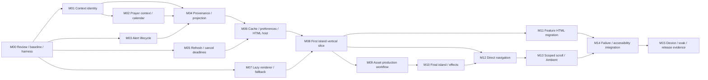

# Living World — incremental implementation roadmap

Status: **proposed**, v0.1, 2026-11-02. No implementation authorized or performed in this session. Task checkboxes live here; [progress](progress.md) records results/evidence without a second task registry. Dependencies: [technical architecture](../specs/03-technical-architecture.md), [performance/accessibility](../specs/07-performance-and-accessibility.md), [product](../specs/00-product-vision.md), [functional](../specs/02-functional-requirements.md), [world/art](../specs/04-world-and-art-direction.md), [camera](../specs/05-camera-and-motion.md), [data/interactions](../specs/06-data-and-interactions.md), [acceptance](../specs/08-acceptance-criteria.md) and [DESIGN.md](../DESIGN.md). All upstream detailed approvals remain unrecorded; do not infer approval from this plan.

## Execution rules and dependency order

One checkbox is a focused implementation session; split again if source inspection reveals wider independent work. Named files below are likely scope, not permission for unrelated cleanup; `new:` marks proposed files. Read callers/tests first. Preserve existing work, compatibility exports, provider/public schemas, settings schema and deployment/secret ownership. No automatic commits. No production code, dependency or tooling installation is part of the current documentation task.

Every future code milestone includes focused meaningful tests plus `npm run test`, `npm run lint`, `npm run typecheck`, `npm run build`. Browser fields below supplement those checks. Record results/limits in progress with evidence metadata from PA-08. A task with missing required hardware/visual/operational evidence remains blocked/not run, not complete. Do not run feed-generation scripts, dispatch workflows or call credentialed providers as routine verification.

Two separate tracks:

1. **Data integrity:** M01–M06 correct audited behavior with the incumbent UI. No scene dependency. Internal metadata additions are scoped contracts; no producer/provider replacement.
2. **Presentation:** M07–M15 progressively add the optional renderer and replace HTML presentation after integrity gates. All feature owners stay mounted once; a single internal, nonpersisted presentation rollout switch can select incumbent vs Living World markup. It never chooses different caches/providers. Keep incumbent view available until final acceptance; no duplicated hidden provider trees. Switching presentation off does not undo integrity fixes.

Static renderer research may proceed after M00 without domain dependence; acceptance of data-derived scenery waits for IG-01–IG-04 and DI-08/DI-09 evidence. The M08 slice is an internal proof, **not** full P1 launch or authorization to skip remaining features. No parallel agents are requested by this plan.

## M00 — Review record, reproducible baseline and verification capability

- [ ] **Scope:** reconcile approval gap C01/C02, confirm C03/C04 staging questions, numeric budgets/browser policy/reference-device access; approve exact dependency recommendation and internal integrity changes before implementation. Inventory existing tests/available browsers and select a verification harness without assuming installed tools.
  - **Dependencies:** none; architecture review first. Missing approvals block dependent implementation, not writing/reviewing this plan.
  - **Likely files:** specs03/07 approval/change history, upstream approval records as authorized, this plan/progress; possible later dev-only browser test configuration/package files in a separate reviewed tooling slice.
  - **Requirements:** TA-01, C01–C09, PA-01/PA-02/PA-08, R05/R06/R10/R13.
  - **Acceptance:** exact reviewed scope/date/message recorded; Node22 clean-install/check environment and named browser/device matrix defined; no claim that unavailable hardware passed. Confirm only one domain owner and source-based active TTLs.
  - **Tests:** rerun baseline four checks; capture build/import sizes, existing test count and failure baseline. Review any proposed dev runner peer/engine versions before installing it.
  - **Browser/visual:** incumbent screenshots at four desktop sizes; keyboard/preferences/reduction baseline; exact browser availability and gaps recorded. No world art pass.
  - **Rollback:** documentation/tooling changes independently reversible; no production behavior change or new workflow required.

## M01 — Context identity for weather and currency

- [ ] **M01a — Weather context acceptance.** Scope: bind accepted weather/cache to full location, timezone and requested units; invalidate old display identity before new labels. Dependencies: M00. Files: `src/features/weather/hooks/useWeather.ts`, `model.ts`, associated hook/provider tests; controller context handoff only as necessary. Requirements: IG-01/DI-02, FR-03/FR-04/FR-10, AC-I01, R01. Acceptance: slow A→B→A, failure and cancellation never publish wrong units/location or loading finalizer; matching cache retains original time. Tests: deferred promises and fake cache/context cases plus common checks. Browser/visual: incumbent weather/forecast/UV during rapid unit/location switching with failure. Rollback: revert this correction as its own change only if needed, keep scene dependence disabled; never hide a failed integrity gate behind the new view.
- [ ] **M01b — Currency pair acceptance.** Scope: requested/returned base+quote identity, positive finite rate and valid reference date; isolate old pair while loading. Dependencies: M00 (M01a patterns reusable, not required). Files: `src/stores/currencyStore.ts`, `src/features/currency/providers/frankfurterProvider.ts`, model/provider/store tests. Requirements: IG-01, FR-11, AC-F11/AC-I01, R01/R08. Acceptance: mismatched base/nonpositive/date-invalid responses rejected, old rate never under new label, fallback names never imply rate support. Tests: pair race/disable/failure and schema fixtures. Browser/visual: selectors/search and unsupported default pair remain usable with explicit unavailable. Rollback: isolate internal validation change; no endpoint/v1 migration, original saved pair preserved.

## M02 — Prayer identity and date validity

- [ ] **M02a — Context-keyed prayer retention.** Scope: dated and backup records bind coordinates/timezone/date/method/school; migration rejects ambiguous legacy backups instead of guessing. Dependencies: M00/M01 context-contract review. Files: `src/stores/prayerTimesStore.ts`, `src/features/islamic/islamicService.ts`, prayer model/deserialization tests. Requirements: IG-01/DI-02, AC-I01/AC-F12, R01/R09. Acceptance: wrong-context backups and unsupported method/school cannot masquerade as requested schedule; source/cache metadata retained independently of Hijri visibility. Tests: seeded legacy records, delayed old responses, settings/disable races. Browser/visual: same-day location/method changes with network failure; prayer off makes no request. Rollback: additive storage version/key handling preserves settings, rejects unsafe records; retain old UI and withhold lighthouse cue until verified.
- [ ] **M02b — Future-prayer/calendar correctness.** Scope: distinguish calculating from unavailable, validate today/tomorrow separately and no past Fajr “now.” Dependencies: M02a. Files: `src/features/prayer-times/calculation.ts`, `src/stores/prayerTimesStore.ts`, prayer component and calculation tests. Requirements: FR-12/DI-05/DI-07, AC-F12/AC-I01, R01/R03. Acceptance: after-Isha valid tomorrow works; missing/past tomorrow unavailable; rollover, DST and multi-day sleep never show wrong date/countdown; cached qualifier survives Hijri off. Tests: fake local calendar/DST/date boundaries. Browser/visual: six-row schedule, off/on, partial tomorrow and hidden-Hijri cache. Rollback: keep provider interface and saved defaults; independent calculation correction can be isolated, no scene cue enabled without proof.

## M03 — Alert lifecycle independent of refresh enablement

- [ ] **Scope:** explicit alert coverage/check state and continuous validity filtering, clear immediately on location/country changes even if coordinator disables provider; keep official text/order/dismissals.
  - **Dependencies:** M00; shared context keys aligned with M01.
  - **Likely files:** `src/features/weather/hooks/useNWSAlerts.ts`, `src/features/alerts/model.ts`, `src/app/useAmbientBriefController.ts`, NWS lifecycle tests.
  - **Requirements:** IG-02/FR-05/DI-02/IN-07, AC-F05/AC-I02/AC-N04, R02/R03.
  - **Acceptance:** A-US→non-US→B-US and late completion clear A; supported-none vs unsupported vs unavailable distinct; expiration within1 s visible and before first visible resumed cue; dismissals survive valid rechecks.
  - **Tests:** fake-clock nearest-expiry, country disabled branch, invalid dates, no-cache/cache error and request races.
  - **Browser/visual:** official fixture banner/dialog, dismissal/reload, hidden expiry and all coverage states in incumbent UI.
  - **Rollback:** keep correction isolated, preserve dismissal keys; scene alerts remain off until full gate passes, no fabricated all-clear fallback.

## M04 — Honest metadata and renderer-neutral projection

- [ ] **M04a — Weather/AQI/alert metadata.** Scope: owner-side accepted context, structured cache/network times and check results; unknown observation timezone/instant stays unknown. Dependencies: M01a/M03. Files: weather/AQI hook models, NWS state, associated tests (split by domain if >5 files). Requirements: IG-03/DI-03–DI-07, AC-I03, R03. Acceptance: loaded/fresh cache not automatically live, expired/invalid context rejected; metadata not parsed from human labels. Tests: table-driven cache/source/null-time/empty cases. Browser/visual: compare original readings against new status, especially AQI null+pollutants and US-none vs failed. Rollback: additive metadata supports incumbent view; preserve original public provider contracts.
- [ ] **M04b — Static feed/row provenance.** Scope: retain feed generation/source age/unknown carried-category age; row-specific quote/provider-time/stale status and partial refresh results. Dependencies: M00. Files: news/market hooks and models, focused tests; no producer scripts/schema changes. Requirements: IG-03/FR-07/FR-08/DI-06, AC-F07/AC-F08/AC-I03/AC-S01, R03/R07/R08. Acceptance: unchanged old JSON never becomes newly generated; partial market not fully refreshed; missing values/times stay null. Tests: partial/carried bucket/unchanged/stale-row snapshots. Browser/visual: status adjacent to each affected reading, proxy names and safe article links preserved. Rollback: revert projection integration separately, leave pipelines intact.
- [ ] **M04c — Pure BriefSnapshot/WorldTargets.** Scope: build shared read-only projection, FX/prayer/calculated qualifiers, global honest outcomes and neutral environment targets. Dependencies: M01/M02/M03/M04a/M04b. Files: new `src/app/presentation/{contracts,buildBriefSnapshot,deriveWorldTargets}.ts`, projection tests; controller composition. Requirements: TA-02–TA-05/IG-03, EN-01–EN-04/DI-03/DI-04, AC-I03/AC-E01. Acceptance: every external value classified, row context/source time retained, unknown weather neutral, no Three/network/storage imports. Tests: domain-state matrix and same accepted revision comparison. Browser/visual: incumbent HTML projection output smoke, no scene yet; numeric/content equality fixtures. Rollback: one adapter integration point, providers unchanged.

## M05 — Bounded refresh and cancellation

- [ ] **M05a — Request/body deadlines.** Scope: bound direct NWS/news/FX/prayer completion and existing shared-client total invocation without introducing new retry loops. Dependencies: M00 approved IG-04 limits. Files: `src/lib/api/apiClient.ts` and tests, then direct provider paths in separate per-domain small changes. Requirements: IG-04/DI-06, AC-I04, R04. Acceptance: direct15 s including body/schema, shared30 s total including backoff/body; oversized Retry-After deferred, seven-provider sweep≤210 s; prayer two days share deadline. Tests: hung Fetch/body, abort, transient retry and backoff ceiling; repeat existing request tests. Browser/visual: stalled endpoints preserve values/settings and show bounded outcomes/progress. Rollback: request-policy changes isolated from presentation and independently reversible after review; never shift deadlines to renderer.
- [ ] **M05b — Publication generations and mounted TTL.** Scope: cancellation guards for all owner writes, StrictMode coordinator cleanup, mounted FX12 h stale check and truthful global results. Dependencies: M01/M02/M03/M04/M05a. Files: controller/coordinator/tests, market hook/shared remote client guard, currency stale predicate; split owner fixes into focused changes. Requirements: IG-04/FR-14/DI-05/DI-06, AC-F14/AC-I04, R04. Acceptance: aborted market cached fallback cannot publish, disabled/cleared/new-context generations ignore late errors/finalizers/times; one coordinator after StrictMode restart, no stale-scan duplication; FX refreshes next visible scan after TTL. Tests: deferred promises/fake timers/offline/hide/reconnect/enable races and sweep summary. Browser/visual: request-count trace through rapid settings and a mounted TTL advance. Rollback: retain verified owner fixes when disabling new view; do not change order/cadence or snapshot producer ownership.

## M06 — Cache trust, privacy controls and independent HTML host

- [ ] **M06a — Validate retained payloads.** Scope: domain cache/context validation for weather/AQI/currency; future dates/corrupt payloads rejected with fail-soft storage behavior. Dependencies: M01/M04. Files: domain cache readers/schemas/tests, existing cache service only if shared behavior requires it. Requirements: DI-08/DI-05, AC-D01, R09. Acceptance: matching valid data retained with original times, corrupt/old-context values never rendered; market expired fallback remains honestly stale per approved retention. Tests: malformed/future records, storage denial, nominal TTL/stale boundaries. Browser/visual: seeded cache/reload/offline views. Rollback: no bulk storage wipe or TTL policy replacement; malformed entries can be discarded safely, leave settings/dismissals untouched.
- [ ] **M06b — Clear actions and persistence feedback.** Scope: cache clear aborts/supersedes responses, clears backups/mounted data, preserves settings/dismissals; market-only clear narrow; session save failure disclosed. Dependencies: M02/M05/M06a. Files: settings data actions, controller/owner clear hooks, prayer backups, settings persistence/tests; split shared UI feedback from owner clearing. Requirements: DI-09/FR-13, AC-D01/AC-F13/AC-S02, R09/R11. Acceptance: no late repopulation, clear semantics accurate; reset changes settings only; session remains usable when storage unavailable. Tests: pending-clear races/storage snapshots and reload; save failure. Browser/visual: Data & Privacy actions, nested dialog focus and coordinate disclosure. Rollback: no destructive migration; a correction cannot be rolled back by restoring deleted cached values.
- [ ] **M06c — Eager semantic world host.** Scope: a presentation shell with existing summary components, station/mode HTML controls, local detail, loading/error/fallback slot; no Three import and no duplicate providers. Dependencies: M04/M05/M06a/M06b. Files: `src/app/App.tsx`, new `src/components/living-world/{WorldSlot,WorldFallback,StationControls}.tsx`, app layout styles/tests. Requirements: TA-02/TA-03/TA-12/PV-04/FR-15/IN-10, AC-F15/AC-N06, R06/R10. Acceptance: complete incumbent feature access while slot fails/loads, no history/persistence side effects, rollout switch chooses markup with one controller. Tests: failing-slot integration, provider-owner count, import graph. Browser/visual: four desktop sizes/reflow, no-world keyboard/settings/refresh, loading/empty/error fixtures. Rollback: switch to incumbent composition; integrity corrections remain active.

**Integrity checkpoint:** before data-derived scene acceptance, AC-I01–AC-I04 and AC-D01 pass with real owner behavior and browser race/expiry traces. Public schemas/pipelines unchanged; request schedules not redesigned. M07's isolated static smoke may be done before this checkpoint, but M08's live projection may not.

## M07 — Deferred renderer and failure boundary

- [ ] **M07a — Exact dependency/build smoke.** Scope: after approval, recheck public peers and install exact selected Fiber/Three/type versions using npm; one lazy Canvas rendering a static local smoke asset. Dependencies: M00/M06c shell (static isolated harness may precede shell completion). Files: package files, new `renderer/WorldEntry.tsx`, `WorldErrorBoundary.tsx`, WorldSlot integration, focused tests. Requirements: TA-01/TA-02/TA-03/PA-L02/FR-15, R05/R06/R12. Acceptance: one Three/React runtime, no native peers, no eager renderer imports, strict TS including library checks; React19 StrictMode cleanup safe. Tests: clean Node22 npm ci/four checks, npm ls/manifest sizes; no unreviewed stack upgrades. Browser/visual: real Chrome/Firefox/Safari context creation and HTML before lazy load; no art acceptance. Rollback: remove optional entry/lockfile additions as one reviewed change or turn presentation off; no data migration.
- [ ] **M07b — Failure bridge and scoped asset lifetime.** Scope: explicit asset/context/shader/import errors to eager fallback; one attempt ID/promise scope and disposal, visible lazy Preferences error state. Dependencies: M07a/M06c. Files: new renderer asset manager/capability/failure modules and tests, WorldSlot, SettingsDrawer lazy host; split settings chunk independently. Requirements: TA-08/TA-12/PA-I05, AC-F13/AC-F15/AC-P06, R05/R06/R10/R12. Acceptance: absent WebGL2/failed shader/chunk/asset keeps HTML and safe retry, no automatic reload/download loop; obsolete results disposed. Tests: failure injections and async errors outside React boundary, disposal/worker counts. Browser/visual: no-WebGL, context loss, offline assets and retry keyboard access. Rollback: still/DOM only, coordinator remains mounted.

## M08 — First island vertical slice and early feasibility gate

- [ ] **M08a — Four-landmark still overview.** Scope: one persistent island with connected terrain, named low-detail authored landmark silhouettes, simple ocean/sky/light and existing HTML rail/ledger host. It is a private feasibility scene, not final WA-03 art; all existing features stay reachable in incumbent HTML. Dependencies: M07 and asset rights for even provisional geometry. Files: new scene assembly/manifest/low assets, camera-safe-lane layout, evidence; isolate asset imports from renderer logic. Requirements: PV-02/OV-01/TA-06–TA-09/C03/C04, PA-L01–PA-L05/PA-R03–PA-R05. Acceptance: first complete four-landmark frame, no startup fly-in; current renderer budget fits; minimum desktop silhouettes/gaps and no-scroll summary validated or conflict recorded. Tests: manifest/path/dimension/resource counters, import/network graph. Browser/visual: four desktop overview shots plus low/still, day/night, detail open without refit; reference A/B timed probe. Rollback: renderer disabled via slot switch, keep scene as nonshipping research artifact; no partial launch claim.
- [ ] **M08b — Observatory data-to-world-to-HTML slice.** Scope: accepted weather/time→pure target→light/condition and same weather/forecast/AQI/UV HTML, one explicit Overview↔Observatory visit, Stop, instant reduced motion and failed-world fallback. Dependencies: M08a and full integrity checkpoint. Files: WorldTargets binding, observatory scene/detail, minimal navigation reducer/driver and tests; stage separately from geometry change. Requirements: TA-04/TA-05/TA-10/EN-01–EN-04/FR-01/FR-03/FR-04/FR-09/FR-10, AC-I03/AC-N02/AC-N03/AC-P01–AC-P04. Acceptance: same accepted context/qualifier in HTML/world; no provider requests from visits/frames; Stop≤100 ms, 0.8–1.6 s bounded trip, reduction instant; failure retains all essential HTML. Tests: projection/nav race/focus generation/request counts and startup resource limits. Browser/visual: clear/rain/unavailable/cached and unit/location change while traveling, keyboard/OS+app reduction; first measured load/frame probe. Rollback: unbind world data/use neutral still; retain verified domain corrections and incumbent HTML.

**Vertical-slice review:** decide continue/revise before investing in final assets or all station interfaces. Required evidence is a running connected island inside real safe areas, one working data/HTML/camera path and complete recovery. If minimum-size composition, peer compile or reference-GPU budgets fail, propose a reviewable revision; do not hide required data or claim graybox is final art. All F01–F16 remain accessible during this proof.

## M09 — Reproducible final asset pipeline

- [ ] **M09a — Tools, ledger and one optimized landmark.** Scope: verify/pin authoring/validator/optimizer/texture encoder capabilities or commission reproducible exports; implement manifest/license ledger and recipe for observatory first. Dependencies: M08 review, asset creator/rights owner. Files: new asset ledger/recipes under `docs/assets/`, public versioned assets, manifest; dev-only tool package changes separately reviewed. Requirements: TA-09/WA-07/WA-08/PA-L05/AC-S02, R11/R12. Acceptance: saved rights evidence, editable source/hash, exact export/optimization commands/versions, zero validator errors and reviewed warnings, standard/low and fallback plate within budgets. Tests: deterministic rerun hashes or documented nondeterminism, extension/bounds/size validation. Browser/visual: postcompression normals/UV/alpha/color/silhouettes across engines and subpaths; low-to-standard≤2 px silhouette shift. Rollback: previous manifest/version; no overwrite of editable originals/unapproved assets.
- [ ] **M09b — Remaining landmarks/terrain/fallbacks.** Scope: apply the approved recipe one asset family at a time to lighthouse, signal station, pavilion, terrain/shore/props; install licensed font binaries after metrics review. Dependencies: M09a. Files: asset manifest/ledger/version directory/font files and token font references; separate commits/sessions per family when requested. Requirements: WA-01–WA-09/DS-02/TA-06–TA-09, AC-E01/VA-08. Acceptance: four final coherent silhouettes, all mandatory low assets resident, total downloads/resources within caps, local day/night fallback≤350 KiB each, attribution complete. Tests: manifest/GLB/resource/license coverage. Browser/visual: six compositions in all engines, thumbnail style review, day/night/low/still and fallback font metrics. Rollback: previous whole versioned manifest to avoid mixed materials; no partial replacement presented as final.

## M10 — Final environment, quality and idle behavior

- [ ] **M10a — Sky/ocean/time policy.** Scope: final restrained sky, sea, contact shading and five-band WA-05 time policy; no new weather service or postprocessing suite. Dependencies: M09/M08b. Files: living-world environment policy/renderer sea/lighting/materials/tests. Requirements: WA-04/WA-05/TA-07/EN-01/EN-04, AC-F06/AC-E01/PA-I01/PA-I02. Acceptance: local-time approximate/valid-sun rules correct, neutral unknown, two-second blends supersede safely, HTML theme atomic and protected. Tests: short daylight, polar/missing/invalid sun times/timezone, location change midblend. Browser/visual: five time states with all shots, no text exposure or camera motion, plain-material fallback. Rollback: validated low static sea/sky, preserve time/status HTML.
- [ ] **M10b — Weather pool and adaptive tiers.** Scope: pooled sparse rain/snow/fog, Subtle/Static policy, quality/resolution controller and single pacing owner. Dependencies: M10a. Files: weather-effect renderer, runtime quality policy/scheduler/resource inventory, tests. Requirements: WA-06/WA-07/CM-06/CM-07/PA-04–PA-06, R05. Acceptance: particle ceilings, no weather inferred from forecast/AQI, zero continuous motion-off/hidden work, no perframe React/Zustand update, resource/frame/downgrade gates measured. Tests: pooled allocation/no growth, visibility/reduction/disposal and quality trigger fake metrics. Browser/visual: storm/snow/fog/stale/unknown across A/B, thermal/idle trace and input latency. Rollback: disable decorative effects, keep authored low/still and HTML; record failed P1 budgets honestly.

## M11 — F01–F16 HTML presentation migration

Each child uses the shared accepted snapshot, preserves existing actions and remains independently accessible in Overview/Journey/Ambient/fallback. Dependencies common to all: M06/M08 integrity+host. No camera travel required for details. Adapt existing feature components rather than creating second domain hooks/stores. Production rollout remains off until M15.

- [ ] **M11a — Clock/location, utilities, Preferences and recovery (F01/F02/F13/F14/F15).** Scope: final rail clock/header and global controls; preserve location consent/search/drawer/provider dialog, show lazy loading/error, apply loaded-density/glass semantics. Files: `ClockHeader.tsx`, settings components, living-world utilities/rail styles, focused tests (split controls from settings polish). Requirements: FR-01/FR-02/FR-13–FR-15/DS-02–DS-08, AC-F01/AC-F02/AC-F13–AC-F15/AC-N03. Acceptance: all original controls work, settings migrate/default correctly, session save failure honest, no new persisted navigation; clock largest. Tests: formatting/settings and invocation/focus behavior. Browser/visual: four desktops, search keyboard/touch/permission denied, nested dialogs, both opacity/density extremes, storage denied, no world. Rollback: incumbent header/settings layout, same owner state and migrations.
- [ ] **M11b — Observatory/context (F03/F04/F05/F09/F10).** Scope: concise rail weather, alert strip/dialog, forecast six/eight, AQI pollutant disclosure and UV/sunset ledger. Files: existing weather/air-quality components, `ContextBar.tsx`, station sheet/styles/tests; split alert modal styling if needed. Requirements: FR-03–FR-05/FR-09/FR-10/OV-02/DS-07, AC-F03–AC-F05/AC-F09/AC-F10/AC-I02. Acceptance: thresholds/units/forecast unchanged, no alerts falsely all-clear, all missing/stale context explicit; local details do not move Overview camera. Tests:14/15/39/40% precipitation, AQI100/101, nulls/expiry/dismissal. Browser/visual: critical alert+long copy, all states and modal/keyboard/touch at four sizes. Rollback: incumbent feature markup only, keep new integrity/state metadata.
- [ ] **M11c — Signal station (F07).** Scope: active topic has one owner across summary/details, featured+two secondary links and all stories expansion, image failures and source ages. Files: `NewsPanel`, `FeaturedStory`, `StoryList`, living-world news sheet/styles/tests. Requirements: FR-07/DI-03/DS-09/FS-01, AC-F07/AC-S01. Acceptance: all8 topics and1–3 selection preserved, no unrelated fill, URL/referrer safety, no camera on topic change, full titles accessible. Tests: existing ranking/category/schema tests plus shared active selection and link/disclosure actions. Browser/visual: empty/topic-empty/partial/stale/broken image/long headline, keyboard/touch and four sizes. Rollback: incumbent NewsPanel under same hook, no pipeline changes.
- [ ] **M11d — Pavilion (F08/F11).** Scope: ledger all3 proxies+first company, same-mode all-selected-company table, market check/cache/source and independent FX reference. Files: `MarketPanel.tsx`, currency context/detail, pavilion sheet/ledger styles/tests. Requirements: FR-08/FR-11/OV-02/DI-06, AC-F08/AC-F11/AC-I03. Acceptance: visible ETF proxy/USD labels, null not zero,1–6 companies accessible; markets off does not disable FX; reference pair/date/source not live. Tests: selection/partial/unchanged check and pair transitions. Browser/visual: all six companies, stale/missing rows, USD/BDT unsupported, independent toggles, keyboard selectors and subpath static-read trace. Rollback: incumbent table/FX markup; public snapshot URL/producer unchanged.
- [ ] **M11e — Lighthouse and development tools (F12/F16).** Scope: enabled next prayer/Hijri in ledger, six-row optional schedule/details and steady valid cue; retain effective DEV tools with honest simulated-domain labels. Files: prayer context component, lighthouse sheet, DevTools/lazy host and DEV-only fixture harness/tests. Requirements: FR-12/FR-16/DS-10/WA-06, AC-F12/AC-F16/AC-S01. Acceptance: off default/no request, Hijri-hidden cache label, no past countdown; DEV market override limitations not called fixed, production excludes demo/tools. Tests: prayer formats/off/on, production settings guard and bundle/runtime demo exclusion. Browser/visual: after-Isha/missing tomorrow/cache/no-Hijri, all modes/fallback, DEV→live reset. Rollback: incumbent prayer/DEV markup; no production fixture fallback.

## M12 — Complete direct navigation and station camera paths

- [ ] **M12a — Reducer, local history and focus effects.** Scope: expand M08 minimal machine to all modes/chapters, selected vs settled vs panel state, intent/focus generations, completed-visit Back and explicit Continue. Dependencies: M08b; final camera validation waits M10. Files: new navigation machine/contracts/tests, app navigation hook, StationControls/WorldSlot effects. Requirements: TA-10/IN-01–IN-04/IN-06–IN-08/CM-05, AC-N01–AC-N04. Acceptance: newest input wins, old completion never replaces newer panel/focus, modal/alert/hide/resize cancel, no URL/history/store persistence or data work; Back differs from Previous. Tests: exhaustive state/event table including failure/reduction during every transition and 32-entry bound. Browser/visual: keyboard/focus traces through interruptions/nested Escape, request spy/history length. Rollback: direct instant HTML selection and Overview-only world, retain summary/data.
- [ ] **M12b — All-pair authored paths.** Scope: stage final poses/corridors for all ten unordered pairs and midpath retargets with continuous safe egress; one driver only. Dependencies: M12a/M10 final geometry. Files: navigation path data/driver, collision-envelope/scene anchor manifest, path tests/evidence. Requirements: CM-01–CM-03/TA-10/IN-02/PA-R01/PA-R02, AC-N02/VA-05. Acceptance: durations/collision/zero roll/safe-lane clearances and all chapter compositions; minimum-size sheet never forces Overview refit; unsolved paths fail gate instead of lengthening silently. Tests:5% route samples, bidirectional and interrupted25/50/75%, exact current-pose retarget, stale callbacks. Browser/visual: six shots/paths in all three engines and A/B, Stop≤100 ms, stable pose during data/hover. Rollback: instant navigation to verified poses plus HTML; full P1 travel remains incomplete until corrected.

## M13 — Scoped Journey gestures and Ambient behavior

- [ ] **M13a — Journey scroll ownership.** Scope: local normalized wheel/pan progress,200 ms release/≤500 ms settle and reduced-motion chapter selection, never document hijack. Dependencies: M12. Files: navigation input hook/region/tests, panel containment styles. Requirements: TA-11/CM-04/IN-05/IN-06, AC-N02/AC-N03. Acceptance: one segment per gesture, latest intent cancels settling, panels/native controls/pinch untouched, Tab exits, no postpan landmark click; narrow/fallback direct chapters/document scroll. Tests: delta modes/direction/tie/idle/cancel/resize and overscroll interactions. Browser/visual: physical mouse+trackpad, keyboard and touch, panels at both ends in Chrome/Firefox/Safari. Rollback: remove gesture binding; Previous/Next/direct navigation complete, record P1 scroll gate incomplete.
- [ ] **M13b — Ambient recession and critical events.** Scope: deliberate entry/exit, wide pose,10 s secondary-control recession without hiding readings; critical alert reveals/cancels without focus theft. Dependencies: M12/M03 and M11 shared controls. Files: Ambient control hook/utility styles, navigation integration/tests. Requirements: AM-01–AM-04/CM-02/IN-07, AC-N04/AC-N05. Acceptance: first link tap works, focused controls do not disappear, no automatic mode entry/tour or old Journey replay; reduced motion instant. Tests: timers/focus/first-tap/alert dedup/mode preservation. Browser/visual: before/after recession, critical alert while modal open/traveling, eight-hour checkpoint inputs. Rollback: always-visible controls and stable Overview until corrected; do not hide required data.

## M14 — Integrated fallback, accessibility and resource recovery

- [ ] **M14a — Failure/retry matrix.** Scope: all failure modes over complete feature UI, plain-material fallback, slow asset deadline, low-memory/cap pressure, twenty retry/disposal cycles. Dependencies: M10–M13. Files: failure harness/tests, WorldSlot/asset manager only for demonstrated bugs, evidence. Requirements: TA-12/IN-10/FR-15/PA-I03–PA-I05, AC-N06/AC-P06. Acceptance: HTML never lost,≤1 s detected failure response, no stale-import reload loop, retry no new provider owner/resources, still→DOM if image fails, stable current mode/pose on success. Tests: WebGL2 absent/context loss/GLB/texture/shader/chunk/body stall and obsolete decode completion. Browser/visual: every mode/selected station, keyboard recovery, real engines plus hardware memory-pressure observation where safe. Rollback: select still/DOM at host; preserve all feature HTML and recorded failed P1 status.
- [ ] **M14b — Full visual/accessibility regression.** Scope: execute complete FS-01/domain/CM/DS matrix across four desktops/reflow, keyboard, screen readers, forced-colors, contrast and reduction. Dependencies: M11–M13/M14a. Files: browser scenarios/evidence/checklist/progress; bug fixes kept in separate focused slices. Requirements: PA-07/AC-F01–AC-F16/AC-N01–AC-N06/AC-E01, VA-01–VA-06, R06/R10. Acceptance: each scenario has actual result; clock hierarchy/readability/surfaces/landmark identity and normal-desktop no-scroll pass; all mode/fallback features reachable. Tests: common suite plus semantic/keyboard/a11y harness; manual VoiceOver/Safari and NVDA/Chrome+Firefox. Browser/visual: rendered screenshots at required sizes/state combinations and interaction recordings; no source-only pass. Rollback: incumbent view switch while fixes proceed; no weakening upstream design or acceptance.

## M15 — Performance, operational and readiness evidence

- [ ] **M15a — Named-device performance and soak.** Scope: execute PA load/frame/resources/idle/hidden/8-hour protocols on A/B plus mobile functional coverage; compare tiers and fix measured bottlenecks separately. Dependencies: M14/M00 device access. Files: evidence, progress, asset inventory/quality tuning only if separately verified. Requirements: PF-01–PF-06/PA-01–PA-08, AC-P01–AC-P06, R05/R10. Acceptance: all hard gates pass, exact measurements/limitations recorded, no unbounded retry resources, correct date/alert/FX/prayer rollover. Tests: five cold runs/p75, three active segments, heap/resource comparison and twenty retries. Browser/visual: real Chrome/Firefox/Safari on named devices, long-session traces/keyboard and low-tier shots. Rollback: keep rollout off, retain incumbent or complete HTML fallback; missing hardware/opaque metrics do not become passes.
- [ ] **M15b — Operations, rights and final rollout review.** Scope: deployed-origin/public-snapshot/keyless-provider CORS/compatibility/license/entitlement review, base-path production preview, source/security diff and final art approval. Dependencies: M15a and operational owner access. Files: evidence/spec history/progress/asset attribution; README drift corrected in a separately scoped docs change; production rollout switch only after recorded acceptance. Requirements: DI-10/AC-O01/AC-S01/AC-S02/VA-08/PV-07, R07/R08/R11/R12/R13. Acceptance: provider support/default pair observed or explicitly blocked for reviewed remedy; no secret/browser dispatch/provider/cadence change; all assets attributed; complete F01–F16/P0/P1 evidence and owner design acceptance. Tests: final four checks, production demo/import/bundle/network and `/`, `/ambient-brief/`, custom base previews. Browser/visual: final six compositions and complete fallback in shipping engines. Rollback: one composition switch/previous artifact under existing deployment process; preserve verified data-integrity fixes/settings. Publishing/commit/deployment requires the user's explicit task authorization; none is implied here.

## Actual feature migration and acceptance coverage

Every inventory feature has an incumbent continuity test before replacement, an HTML acceptance boundary, a renderer-independent failure scenario and final all-mode/fallback verification. “World” never means provider moved into renderer.

| Inventory | Migration order / HTML boundary | Tests and acceptance destination |
| --- | --- | --- |
| F01 clock/date/location | M06 host→M08 slice→M11a rail; lighthouse later | AC-F01; selected zone/invalid fallback, seconds cadence and no announcements; remains primary offline |
| F02 manual/device location | M01 context→M11a existing Preferences | AC-F02/AC-I01/AC-S02; debounce/confirm/cancel/permission/naming failure, no automatic geolocation |
| F03 weather/insight | M01a/M04a→M08b→M11b | AC-F03/AC-I01/AC-I03; units/retention/neutral unknown, no old-context relabel |
| F04 hourly/precipitation | Same owner as F03→M08b/M11b | AC-F04; six/eight,15/40% thresholds, time format, no independent fetch |
| F05 NWS | M03/M04a→M11b/M13b | AC-F05/AC-I02/AC-N04; country/expiry/dismissal/critical/failure availability |
| F06 atmosphere/daylight | Incumbent fallback retained→M08 static→M10 final | AC-F06/AC-E01/AC-P01–AC-P06; lighting/weather/motion/hidden semantics |
| F07 news | M04b→M11c signal summary/details | AC-F07/AC-I03/AC-S01; all8 topics,1–3 settings, links/images/empty/partial/source times |
| F08 markets | M04b/M05b→M11d pavilion | AC-F08/AC-I03/AC-I04/AC-S01; proxies/nine supported symbols, all selected rows, partial/unchanged/no credentialed calls |
| F09 AQI | M04a/M06a→M08b/M11b | AC-F09/AC-I03; null AQI+pollutants, units/freshness, accessible popover |
| F10 UV/sunset | Weather context→M08b/M11b ledger | AC-F10/AC-I01; null values/timezone/format/shared weather qualifier, no new service |
| F11 currency | M01b/M05b→M11d | AC-F11/AC-I01/AC-I04/AC-O01; reference date/pair/list+rate errors/unsupported support |
| F12 prayer/Hijri | M02→M11e lighthouse | AC-F12/AC-I01/AC-I03; off/default, method/school/date, six rows, valid next, Hijri-hidden cache |
| F13 Preferences/privacy | M06b/M06c→M11a plus existing feature settings | AC-F13/AC-D01/AC-S02; schema2 migration, loaded density/glass, save denial, clear/reset/focus/lazy failure |
| F14 connectivity/refresh | M04c/M05→M06 host/M11a | AC-F14/AC-I04; ordered refresh/partial outcome/offline no-cache/resume, unchanged source time |
| F15 crash recovery | M06c/M07→M14 all features | AC-F15/AC-N06/AC-P06; whole-app vs isolated world, keyboard recovery and retry disposal |
| F16 DEV diagnostics | Existing tools remain→M11e DEV harness | AC-F16/AC-S01; truthful simulated domains, production demo-off/tool exclusion; incomplete market override deferred |

## R01–R13 risk ownership and blocking conditions

| Risk | Remediation / gate | Boundary and residual risk |
| --- | --- | --- |
| R01 context mismatch | M01/M02/M04/M05; AC-I01 before M08b | Full context generation, backup validation, no relabel race; no rendering workaround accepted |
| R02 stale alerts | M03; AC-I02 then M13b escalation | Clear disabled provider state and exact expiry/resume; official source only |
| R03 incomplete provenance | M04; AC-I03 before data-derived world | Conservative unknowns/internal metadata; no v1 producer schema migration assumed |
| R04 refresh/cancel gaps | M05; AC-I04 and M15 soak | All writes guarded, body/backoff bounded, mounted FX TTL; frame work owns no fetch |
| R05 GPU/load/thermal | M07/M08 early probe, M10 quality, M15 named-device proof | PF caps remain provisional until review/measured; reference fallback not automatic P1 pass |
| R06 access/motion | M06 HTML independence, M11–M14, AC-N03/AC-N06 | Semantic features/focus preserved; actual screen-reader/hardware evidence needed |
| R07 pipeline/secrets | Every diff; M04b/M11d/M15b AC-S01/AC-O01 | Preserve Actions-only keys, validation/atomic retention and producer ownership, no dispatch from browser |
| R08 availability/quotas | M01b/ M05 semantics; M15b operational gates | No cadence increase or Frankfurter migration; entitlement/default pair unresolved may require separate approved scope |
| R09 cache trust/clear | M02/M06; AC-D01 before M08b | Validate payloads and invalidate late repopulation; settings/dismissals not erased |
| R10 verification gaps | M00 harness/device matrix, M14/M15 evidence | Missing device/runner not a pass; no claim static markup proves focus/3D |
| R11 assets/privacy | M06b/M09/M15b; AC-S02/VA-08 | Ledger/rights/local assets, preserve news referrer guards and coordinate disclosure; rights owner unresolved |
| R12 subpaths/portability | M07/M09/M15b; AC-P02/AC-O01 | All model/decoder/font URLs base-safe. Existing repository-specific market URL stays pending explicit fork/move request |
| R13 UI/tooling drift | M00/M11a/M11e/M15b documentation | Loaded density completed under FR-13, DEV limitations honest, cron prose corrected separately; no global tooling cleanup |

## Requirement-to-evidence completion rule

All upstream FR/FS/OV/JY/AM/DI/IG/EN/IN/PF groups map through 08's coverage index to the feature/mode/data/performance gates above. DS/WA/CM map through VA-01–VA-08 to M08–M15. TA and PA traceability is in their own specs. Every acceptance result must name a milestone and actual evidence; broad “all tests pass” does not close visual, source compatibility, rights or GPU requirements.

New requirements/thresholds needing review include exact stack, 32-entry visit bound,8 px click-suppression threshold,15 s asset attempt timeout, quality trigger, detailed chunk/font/CPU/heap allocations, browser support policy and internal metadata shapes. Final camera geometry, asset rights/creator, device access and operational compatibility remain evidence-dependent. None blocks completion of this documentation package; all block dependent implementation/readiness claims as applicable.

2026-11-02 — roadmap v0.1 authored. All implementation tasks **unchecked/not started**. No app source/package/workflow/secret or generated data change made, and no commit/deployment performed. See [progress](progress.md) for this session's actual checks and next review step.
