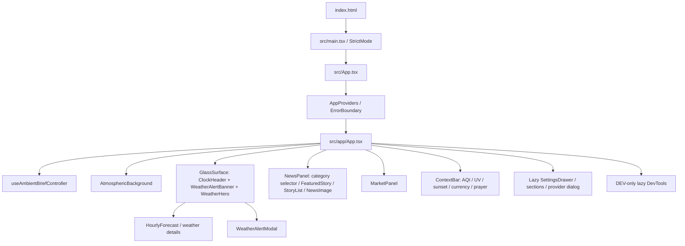
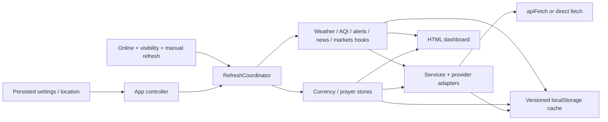

# Ambient Brief 2.0 — existing-system audit

Status: **draft research baseline, ready for review**. Audited 2026-11-02. Application baseline: `0f91c2fedde89f7d495a4c7a7d0d8c2941a56876`, branch `redesign/living-world-v2`, plus the existing working-tree guidance/tooling changes. This report does not approve a rendering stack, feature specification, or implementation.

## Objective, scope, and evidence

Establish what Living World must preserve before specifying a new presentation. The intended island comprises an observatory, lighthouse, signal station, and market/currency pavilion; Overview, Journey, and Ambient remain future capabilities, not existing behavior.

Acceptance for this research task:

| ID | Criterion | Evidence |
| --- | --- | --- |
| AUD-01 | Trace architecture, components, navigation, state, tooling, and deployment | Architecture and operations below; source references |
| AUD-02 | Inventory actual visible capabilities, interactions, and failure states | [Feature inventory](../docs/current-feature-inventory.md) |
| AUD-03 | Record service contracts, refresh, validation, credentials, and data limitations | [Data contracts](../docs/data-contracts.md) |
| AUD-04 | Classify reuse and evaluate 3D without installation | Migration matrix and rendering feasibility below |
| AUD-05 | Rank risks and identify next-specification decisions | Risk register and unresolved questions below |
| AUD-06 | Execute baseline checks; leave existing failures and functionality untouched | Verification below; documentation-only task diff |

**Evidence labels:** “Verified in source” means the current source implements the described path; it does not establish runtime correctness in every browser. “Executed” means a command ran in this audit. “External documentation” means official documentation reviewed on the audit date. “Inference/recommendation” means a proposed boundary or risk, not an approved requirement. Historical tooling/audit claims were not treated as new verification.

Read: [AGENTS.md](../AGENTS.md), [development workflow](../docs/development-workflow.md), [skill routing](../docs/skill-routing.md), [README](../README.md), [agent tooling](../docs/agent-tooling.md), existing design-system guidance, package/build/lint/compiler configuration, application modules, provider schemas, workflows, and relevant tests. Applied the installed spec-driven-development workflow to research scope and reviewable evidence. Per project authority, this is an audit in `specs/`, not a new root specification or design document. No implementation plan is needed for this documentation task.

Assumptions: existing product behavior is the migration baseline, but verified weaknesses are findings rather than behavior to perpetuate blindly. Provider account entitlements, Actions secret presence, and live deployment health are unknown. No app/server/provider replacement is authorized.

## 1. Current architecture

### Stack and entry points

Verified in package configuration and installed packages:

| Area | Current implementation |
| --- | --- |
| Runtime | React / React DOM 19.2.8 installed; manifests specify `^19.0.1`; client-rendered SPA |
| Build | Vite 6.4.3 installed, React Vite plugin 5.2.0, ESM; no SSR/backend |
| Language | TypeScript 5.8.3, strict, ES2022, bundler resolution, `react-jsx`; `@/*` → `src/*` |
| Styling | Tailwind 4.3.3 installed through Vite plugin; global CSS and tokens |
| State | Zustand 5.0.14; React local state for domain hooks and interactions |
| Validation | Zod 4.4.3; provider and generated-file schemas |
| Utilities | date-fns 4.4.0, lucide-react 0.546.0, browser Intl/Fetch/Storage/Geolocation |
| Checks | Vitest 4.1.10, ESLint 9.39.5, TypeScript no-emit; npm and package-lock authoritative |
| Absent | Router, service worker, 3D renderer, scene assets, browser E2E runner, server API |

`index.html` loads `src/main.tsx`, which creates the root under React StrictMode. `src/App.tsx` is a compatibility shell around `src/app/AppProviders.tsx` and `src/app/App.tsx`. AppProviders currently provides only the top-level ErrorBoundary. There is no context-provider graph to replace.



The diagram reflects source imports/render paths, not a browser recording. Source: `src/app/App.tsx`, `src/components/`, `src/features/*/components/`.

### Navigation and user interface state

One page, no URL router, route persistence, deep linking, or browser-history navigation. News categories use local selection. Preferences have five local tabs: General, Content, Appearance, Optional, Data & Privacy. Weather details, hourly forecast, additional news, prayer schedule, AQI/currency popovers, and alert/provider dialogs expand locally. An `open-settings` window event is also handled by the controller. Future camera navigation/mode state is additional functionality; it must not silently replace these interactions.

### State and orchestration

`src/app/useAmbientBriefController.ts` owns provider composition, refresh orchestration, online state, settings visibility, alert selection, manual-refresh summary, and settings dependency fingerprints. It combines hook-local weather/AQI/news/alert/market states with Zustand currency/prayer/settings stores. Several consumers subscribe to whole stores; the controller also refreshes its `latest` ref each render to keep coordinator callbacks current.

`src/stores/settingsStore.ts` persists schema-2 settings under the historical key `ambient_brief_settings_v1`; migration validates with Zod, fills defaults, strips unknown legacy fields, and forces production demo mode off. Legacy Alpha Vantage storage is removed during restore. `src/lib/stores/*`, `src/lib/types/index.ts`, and `src/types/index.ts` remain compatibility exports; they are not independent stores or duplicated domain implementations.

Other stores: currency list/rate/loading/error/stale state; today/tomorrow prayer schedules and countdown; development state; API diagnostics. UI-local state is not persisted. Browser storage holds location preferences and data caches; there is no account or synchronization service.



The shared `RefreshCoordinator` scans stale providers every 60 seconds and starts initial requests sequentially in this order: weather → AQI → US alerts → optional prayer → enabled currency → news → enabled markets. It deduplicates per-provider requests, aborts on offline/stop and affected settings changes, skips routine work while hidden, and rechecks on visibility/reconnection. Manual global refresh forces enabled providers; weather/news retry uses `settingsChanged` and is not a force-refresh call. Individual market refresh directly invokes the market loader; it is outside coordinator sequencing but uses the shared request client's deduplication. Prayer internally fetches two days concurrently. Thus sequencing reduces bursts but is not a universal single-request guarantee.

The clock updates its own component every second; the atmospheric background samples time every five minutes, with continuous CSS animation. Prayer countdown updates every minute. Frame animation does not currently drive fetches. `src/hooks/useVisibilityRefresh.ts` has no application caller; the coordinator is active.

### Services, cache, and validation

Provider-specific normalization is mostly isolated under feature folders. Location search/reverse naming live in `src/lib/services/`. Weather and news retain small service facades. Prayer's feature `service.ts` re-exports the implementation in `src/features/islamic/islamicService.ts`.

`apiFetch` supports Zod schemas, typed errors, timeout, safe-method transient retries, cancellation, and Retry-After. Weather/AQI/location/markets use it. News, NWS, Frankfurter, and AlAdhan directly use Fetch; they do not inherit its timeout/retry policy. The global sequential refresh can therefore wait indefinitely on a stalled direct fetch until an external abort.

`cacheService` validates versioned envelopes and timestamps, not arbitrary domain payloads. `getCache` rejects expired entries; `readCache` exposes them. `loadRemoteData` supplies deduplicated stale-while-revalidate and may retain even expired data on failure/offline. Markets use that client; other features mostly implement their own cache logic. News, markets, and prayer deserialize/revalidate their cached payloads; generic weather/AQI/currency cache reads trust their typed payload. See [data contracts](../docs/data-contracts.md) for exact effective policies; constants named “news,” “markets,” or “prayerSchedule” in central policies are not all the active implementations.

### Styling and motion

`src/index.css` (1,480 lines) imports Tailwind and `src/lib/styles/tokens.css`. Shared semantic colors, typography, spacing, glass, and numeric treatments coexist with utility classes and component-specific global selectors. `GlassSurface` reads the glass-intensity setting; the app shell and CSS apply reduced-motion rules. The main desktop layout uses CSS grid areas; viewport-height/width breakpoints alter density and news story counts. Fonts use a local/system fallback stack; no font-loading service is configured.

`AtmosphericBackground` derives time/weather/light through `features/weather/utils/atmosphericCalculator.ts`, then renders a decorative DOM background with three haze spans and pseudo-elements. CSS handles motion, OS reduced motion, and visibility pause. Application reduced motion forces static atmosphere and adds a global class. These CSS protections do not automatically govern a future WebGL animation loop. Content density affects skeletons; searches found no equivalent loaded-content density branch. Existing tokens are a baseline, not the Living World visual specification.

### Tooling and Graphify evidence

Reviewed installed tooling documentation and provenance/verification records. Primary workflow: spec-driven-development; project Graphify supports architecture research. Impeccable, Taste, Design Review, Karpathy, Ponytail, and reference DESIGN.md templates are available but were not activated to redesign anything. Documentation records disabled Impeccable hooks/telemetry, unresolved duplicate skill discovery, and a historical unrelated global skill YAML error; those were not revalidated or fixed. Chrome DevTools MCP is not supplied merely by installing its skill. No hook, agent configuration, plugin, or dependency was changed.

Executed a scoped Graphify AST extraction:

```sh
graphify extract src --code-only --no-cluster --max-workers 2 --out /private/tmp/ambient-brief-audit-20261102
graphify query 'useAmbientBriefController RefreshCoordinator settingsStore' --graph /private/tmp/ambient-brief-audit-20261102/graphify-out/graph.json --budget 1500
graphify diagnose multigraph --graph /private/tmp/ambient-brief-audit-20261102/graphify-out/graph.json --max-examples 2
```

Corpus: 142 code files; 637 nodes and 1,805 edges. No semantic LLM extraction or clustering; semantic input/output tokens: 0/0, no API credential or model cost. Vendored skills/references and generated data were outside the source-only corpus. CSS was not indexed: `index.css` unclassified, `tokens.css` flagged as potentially sensitive by filename (it is styling, manually inspected). Twenty-six code files yielded no symbols, including re-exports/tests. Extraction did not cover workflows or Node producer scripts; those were inspected directly. The query returned 275 related nodes but displayed only 56 at the budget; it was used to locate hubs, then source was read directly.

**Graph health limitation:** no missing/dangling endpoints, self-loops, or exact duplicate edges; 45 directed same-endpoint relation variants could collapse in a simple DiGraph (46 undirected). Do not treat graph counts or traversal absence as exhaustive proof. The graph identified controller/settings, feature hooks, and compatibility barrels as migration touchpoints. Artifacts remain temporary and are not a fourth committed deliverable; no repository index/watch hooks were added. No HTML graph was needed for this structural-only investigation.

## 2. Operations and deployment

| Workflow | Verified behavior and preservation boundary |
| --- | --- |
| `.github/workflows/deploy-pages.yml` | `main` push or manual; Node 22/npm ci; typecheck, lint, tests, build; upload `dist`, deploy Pages; Pages/ID-token permissions, cancellation group `pages` |
| `.github/workflows/update-news.yml` | Default branch only; cron `7,37 * * * *`; five authenticated Currents requests/run; commit changed `public/data/news-feed.json`, then explicitly dispatch Pages (bot commits do not themselves trigger the push workflow); contents/actions write permissions |
| `.github/workflows/update-market-data.yml` | Default branch only; cron minutes **11,26,41,56** at UTC hours 8–23 weekdays, 0–1 Tue–Sat, plus `26 17 * * 0,6`; manual force option; retrieve prior snapshot, generate, validate, publish an orphan `market-data` branch using force push; contents write only; no frontend redeploy |

README currently says markets run at 7/22/37/52; the workflow above is the verified schedule. Left unchanged in this audit. Scheduled Actions are opportunities, not delivery guarantees. Both producers validate responses, use bounded request timeouts, retain prior valid data on partial failures, write atomically, and fail without replacing the file on total failure. Market session estimation uses New York weekdays/clock time, without holidays/half days.

Vite honors explicit `BASE_PATH`, otherwise derives a repository subpath in Actions; `.github.io` repositories use `/`. News uses `import.meta.env.BASE_URL`; markets use a hard-coded public raw-GitHub URL in `features/markets/config.ts`, which needs an explicit fork/move decision. No secrets are frontend configuration. Local frontend build requires no provider key. Account secrets, repository protection/Pages settings, successful scheduled execution, deployed CORS, and actual production artifact were not inspected remotely.

## 3. Reuse and replacement recommendations

Classification is by responsibility, not permission to edit/delete. A module can contain reusable behavior and replaceable view markup.

| Class | Code / responsibility | Recommendation |
| --- | --- | --- |
| A — reusable without significant change | `src/features/*/model.ts`, provider schemas; weather/AQI/NWS normalization; news generation/ranking/deduplication/URL guards; market schema/instruments/producer; formatting and prayer calculation; location adapters | Preserve public contracts, tests, and provider isolation. See contract caveats before assuming scene readiness. |
| A | `src/lib/api/*`, settings store/defaults/migration, compatibility exports, three workflows and Vite base-path logic | Retain operational/security behavior. Known defects below need separately scoped remediation, not incidental cleanup. |
| B — reusable with adapters | App controller and refresh coordinator outputs; weather/AQI/news/market hook state; currency/prayer stores; atmospheric time/weather calculations | Project into renderer-neutral state, retaining freshness, source and timestamp semantics. Avoid whole-store or frame-rate updates through App. |
| B | Preferences logic, location selection, dialogs/disclosures, failure/retry behavior, dev diagnostics | Retain functions and accessible interactions; adapt layout, ownership, focus, and settings migration when new modes are specified. |
| C — primarily presentation | `src/app/App.tsx` layout, `AtmosphericBackground`, `GlassSurface`, global dashboard layout CSS, skeletons, clock/weather/news/market/context markup | Replace visual composition under an approved design. Preserve semantic HTML, interactions, and data-state coverage; do not replace readable data with mesh text alone. |
| D — potentially unnecessary | Uncalled `useVisibilityRefresh`; unused `RemoteState<T>`; compatibility policy aliases including 4-hour market TTL; legacy `CurrencyRate` schema/model; mock-only `IslamicDaylightInfo`; `ProviderSettingsSection` used by tests, not runtime | Candidates for later reference verification and cleanup review. No deletion recommended as part of this audit. |
| D — limited/incomplete controls | Dev market status is written but not consumed by `useMarkets`; density affects loading skeletons rather than loaded views | Do not promise these as fully working capabilities. Decide their future behavior explicitly. |

Compatibility barrels and the `islamicService` implementation are still used and must not be mistaken for dead duplicates. `mocks/ambientData.ts` remains an explicit development aid; it is not an acceptable production fallback. No source, stylesheet, workflow, dependency, lockfile, or generated feed was edited here.

## 4. React Three Fiber / Three.js feasibility

**Conclusion (inference): feasible as an optional presentation layer; not yet selected or experimentally validated.** No dependency was installed and no 3D prototype ran.

| Concern | Assessment and required next-specification constraint |
| --- | --- |
| React / TypeScript / Vite | Current official R3F introduction pairs Fiber 9 with React 19; Fiber 10 is currently alpha. Use the compatible stable major if selected; verify exact peer ranges and Three/types versions before an approved install. Existing TSX/ESM/Vite needs no routing or backend change. [R3F introduction](https://r3f.docs.pmnd.rs/getting-started/introduction) |
| WebGL | Current Three WebGLRenderer requires WebGL 2; WebGL 1 support ended at r163. Browser/device presence does not prove context availability (policy, GPU, resources, context loss). Specify capability detection, renderer-error isolation, asset-failure handling, and a complete HTML fallback. [Three renderer](https://threejs.org/docs/pages/WebGLRenderer.html) |
| Canvas lifecycle | Prefer one stable canvas for the coherent island, surviving mode/feature selection. Avoid remounts on clock/data changes. StrictMode requires cleanup-safe setup; specify disposal of owned geometry/material/texture resources, listeners, timers, camera jobs, and context-loss recovery. Canvas fallback alone is not all failure recovery. [Canvas API](https://r3f.docs.pmnd.rs/api/canvas) |
| State synchronization | Keep polling/controller mounted independently of renderer availability. A renderer-neutral projection should combine normalized domain data with provenance/age and motion preferences; scene subscriptions should select narrow fields. Clock/camera frame state must not cause React-wide or store-wide updates. |
| Bundle splitting | Lazy-load the world/renderer behind Suspense and an error boundary; mount readable HTML immediately. Existing lazy SettingsDrawer demonstrates splitting. Keep Three imports out of eagerly loaded shared barrels. Set measurable initial JS, world chunk, texture/model, and decode budgets before implementation. [Vite 6 features](https://v6.vite.dev/guide/features) |
| Pages and assets | Static JS/models/textures can deploy through the current artifact. Imported assets and runtime URLs must respect repository base paths; explicitly handle model/decoder/environment-map URLs. Same-origin assets avoid third-party texture CORS dependencies. Verify `/ambient-brief/` production preview. No Pages workflow or credential changes are inherently required. [Vite 6 build](https://v6.vite.dev/guide/build) |
| Animation | Use one renderer loop and delta-time mutation for camera/scene animation. Specify mode transitions, cancellation, pause/resume, hidden-tab behavior, and reduced-motion alternatives. Demand rendering helps resting/static scenes, but continuously animated weather must deliberately invalidate or use an active loop. Bound pixel ratio and effects. [R3F performance](https://r3f.docs.pmnd.rs/advanced/scaling-performance), [pitfalls](https://r3f.docs.pmnd.rs/advanced/pitfalls) |
| HTML overlays | Keep clock/date, weather/alerts, news links, prices, settings, and mode/station controls semantic and keyboard accessible. Canvas is a sibling presentation surface; shared selection state can synchronize station focus and HTML. Specify stacking, pointer ownership, focus return, screen-reader behavior, modal/camera suspension, and equivalent keyboard operations. A mesh click cannot be the sole feature entry point. |
| Alternatives | Direct Three.js is technically possible but adds manual scene ownership/lifecycle synchronization. Existing DOM atmosphere remains a useful fallback candidate. Neither option is selected by this audit. No need to introduce an animation framework or helper package before requirements justify it. |

## 5. Ranked risks

Severity combines effect and exposure, not a measured probability. Source-traced findings are not claimed browser reproductions. No fixes were applied.

| ID / severity | Evidence / consequence | Mitigation to specify |
| --- | --- | --- |
| R01 High — context mismatch | Prayer backup keys are global; fallback checks only date, not location/method/school. Existing schedules can survive a context change. Currency displays settings pair alongside previous store rate while a new pair loads; weather can retain old-unit values during a unit switch. Incorrect context can look current. | Context-keyed last-good data and explicit transition identity; test location/unit/pair/method switches with failure/cancellation. |
| R02 High — alerts persist after location change | Alerts are hook state; coordinator disables the alerts provider for non-US settings before calling its unsupported-location clearing branch. Old US alerts can remain; expiry filtering runs on load, not continuously. | Explicit clearing/filtering on context change and expiry; distinguish unavailable from no active alerts. Keep official alert text accessible outside 3D. |
| R03 High — provenance is incomplete | `DataFreshness` vocabulary exists but active state shapes vary; weather drops observedAt/weather code, NWS returns an array, news has only feed-level partial/age metadata. Fresh cache may be labeled loaded/Live; partial market network success can count as refreshed. | A read-only presentation adapter with honest per-value source/age, unavailable semantics, and no invented precision. Any producer schema change requires reviewed compatibility. |
| R04 High — refresh and cancellation gaps | Currency stale predicate uses `isStale || !rate`, not elapsed cache TTL, so a successful mounted rate may never routinely refresh. NWS/news/currency/prayer direct fetch lacks bounded timeout. Shared client returns cached fallback even on abort; `useMarkets` has no post-await signal guard. | Scope targeted refresh/cancellation corrections before scene dependence; test long-lived tabs, StrictMode, hide/reconnect, disabled modules, and rapid settings changes. Do not alter polling in render code. |
| R05 High — GPU/load/thermal cost | No measured GPU, frame, asset, memory, or power budget exists; ultrawide and high-DPR cost can multiply. Existing DOM build is already 431.56 kB JS before 3D. | Name target hardware/browser, set asset/frame/DPR budgets, hidden-tab pause, quality reduction and static fallback; measure before acceptance. |
| R06 High — accessibility/motion regression | Canvas has no semantic equivalent by itself; current HTML interactions/focus can be obscured by guided motion or overlays. Existing CSS reduced motion does not control WebGL. | HTML access to every essential value/action, keyboard station/mode controls, motion-off camera path alternative, runtime focus/contrast testing at all target sizes. |
| R07 High — pipeline/secret regression | Two intentionally different authenticated producer pipelines; moving requests to browser exposes secrets. News commits trigger redeploy; markets force-publish a data branch. | Preserve pipeline ownership, secret headers, atomic validation and total-failure retention; no client GitHub dispatch, keys or proxy. |
| R08 Medium — data availability / quotas | Currents nominal 240 requests/day is near currently documented free 250/day; stale news can be rechecked on each minute coordinator tick; manual runs consume headroom. Finnhub entitlement unverified; Frankfurter v1 is deprecated and source query parameters differ from current documented names; cron/session/holiday estimates and CORS may drift. | Preserve cadence; monitor workflows and per-symbol/feed age, verify account quota/license and deployed-origin access. Do not infer real-time guarantees from network success. |
| R09 Medium — cache trust and retention | Generic cache checks envelopes only; weather/AQI/currency payloads not revalidated on read. Shared remote client permits expired fallback; clear-all leaves prayer backup/dismissal keys and mounted data. | Specify validation/retention/clear semantics by domain; never show corrupt or old-context data as current. |
| R10 Medium — limited verification coverage | Unit/helpers/static markup tests do not exercise actual keyboard dialogs, GPU, layout, provider CORS, or long-running behavior. | Add browser acceptance evidence and state/failure scenarios in future spec; no claim that current checks prove visual/accessibility readiness. |
| R11 Medium — external assets/privacy | News images are third-party; scene assets may add texture CORS, licensing, tracking, and download risks. Device coordinates are stored and sent to data providers. | Keep image URL guards/referrer controls; document provider disclosure and licensed local scene assets with budgets. Credentials remain Actions-only. |
| R12 Medium — base path and portability | Market URL is repository-specific; model and decoder runtime URLs could bypass Vite base. | Centralize public asset URLs, validate production subpath and forks; retain current base handling. |
| R13 Low — UI/tooling drift | README market cron differs from YAML; some density/dev controls are limited; tooling discovery issues are historical. | Keep specifications grounded in source and runtime checks; resolve cleanup separately. |

## 6. Existing baseline — executed

Environment: macOS Darwin arm64, Node `26.13.0`, npm `11.20.0`; application CI specifies Node 22. Used installed dependencies; no `npm ci`, upgrades, vulnerability audit, credentials, feed-generation command, workflow dispatch, deployment or commit ran.

| Check | Result |
| --- | --- |
| `npm run test` | PASS — 31 files, 160 tests; Vitest 4.1.10; 1.11 s reported duration |
| `npm run lint` | PASS — zero lint warnings/errors under `--max-warnings=0` |
| `npm run typecheck` | PASS — `tsc --noEmit` |
| `npm run build` | PASS — includes typecheck; Vite 6.4.3; 1,843 transformed modules; 1.05 s reported Vite build |
| `npm ls --depth=0` | PASS — installed versions recorded above; no missing package output |
| Git scope | Pre-existing modified AGENTS/README and untracked tooling/spec/plan directories preserved; task adds only the three requested Markdown documents |

Build output (decimal kB as Vite reports): HTML 0.49 / gzip 0.31; CSS 100.77 / gzip 18.99; main JS 431.56 / gzip 128.83; lazy SettingsDrawer 28.37 / gzip 8.21. These are emitted artifact sizes, not network transfer, startup timing, FPS, memory, or future performance budgets. `dist` is ignored build output.

Tests emit Node's pre-existing experimental localStorage warning (`--localstorage-file` not provided). No pre-existing check failed and nothing was silently fixed. Some tests intentionally simulate provider failure; their diagnostics are test output, not a production outage. Coverage emphasizes request/cache/coordinator behavior, provider normalization, settings migration, news generation/ranking/URLs, AQI/weather/prayer utilities, and market generation/rendered static markup. There is no configured coverage threshold, browser E2E suite, visual suite, accessibility gate, GPU/performance test, or test of actual settings focus behavior.

Local committed news snapshot: generated `2026-11-02T09:53:09.427Z`, success, 5/5 requests, 100 pre-dedup / 92 post-dedup articles; Top/U.S./World/Business/Sports/Entertainment each 16, Technology/Science each 13 (bucket membership overlaps). This is file inspection, not proof the remote feed or upstream account works now. It is older than the app's 75-minute generated-feed threshold at audit execution.

**Unverified:** rendered browser states/screenshots, supported-size no-scroll behavior, keyboard and reduced-motion behavior in runtime, deployed-origin CORS, actual Actions runs/secrets/branch permissions, present Finnhub snapshot availability, live rates/prayer/weather, Node-22 clean install, dependency vulnerabilities, and GPU feasibility on named hardware. No application/UI changes were made, so this audit does not claim new visual verification.

## 7. Recommended architectural boundaries and next questions

Recommendations for review, not a capability map or approved module spec:

1. Preserve feature providers, generated-file contracts, cache ownership and existing refresh coordinator outside rendering. Do not mount providers per building or camera mode.
2. Define one renderer-neutral presentation projection between normalized domain state and both HTML and world visuals. Carry context identity, source, observation/publication/fetch times where available, and truthful freshness. Mark missing metadata unknown rather than fabricate it.
3. Keep settings migration/persistence separate from transient camera/mode/selection state. Define whether any new view state persists before changing the schema.
4. Isolate optional world loading, errors, animation and asset lifetime from essential HTML. Specify equivalent controls and functional fallback before selecting a renderer.
5. Keep existing static hosting and producer/security boundaries. Scene assets must be compatible with repository subpaths and budgeted independently of provider data.

Material unresolved questions for the next specification phase:

- Which stable rendering stack and exact compatible version family will be selected after review? What minimum browser/WebGL capability and device class must work?
- What are the target hardware, ultrawide dimensions/DPR, frame-time, initial-load, decoded-asset, GPU memory and hidden-tab budgets, and how will they be measured?
- What do Overview, Journey and Ambient each show, hide, and allow? What are camera timing, interruption, station selection, keyboard, focus, modal, and resume semantics?
- What usable experience is required for no WebGL, context loss, renderer/chunk/asset failure, reduced motion, and optional modules disabled?
- Which source-traced integrity gaps (R01–R04/R09) must be corrected before world integration, under separate reviewed acceptance criteria? May weather/other contract metadata be extended, or must the first adapter tolerate missing fields?
- How should stale/cached/unavailable information affect world atmosphere without implying current weather or current quotes? Which information must remain continuously visible during journeys?
- Are current provider plans, licenses, attribution and rate entitlements sufficient for intended distribution, and who verifies Actions secrets/production CORS? Does the default currency pair need a supported v1 alternative?
- Who owns scene assets, their license/provenance, optimization and fallback art? How should old appearance preferences migrate when world quality/motion controls are defined?

Change history: 2026-11-02 — requested research audit authored; no design, stack selection, implementation approval, or product code change. Review of this evidence can inform the next feature/capability specification; it does not authorize building the world.
