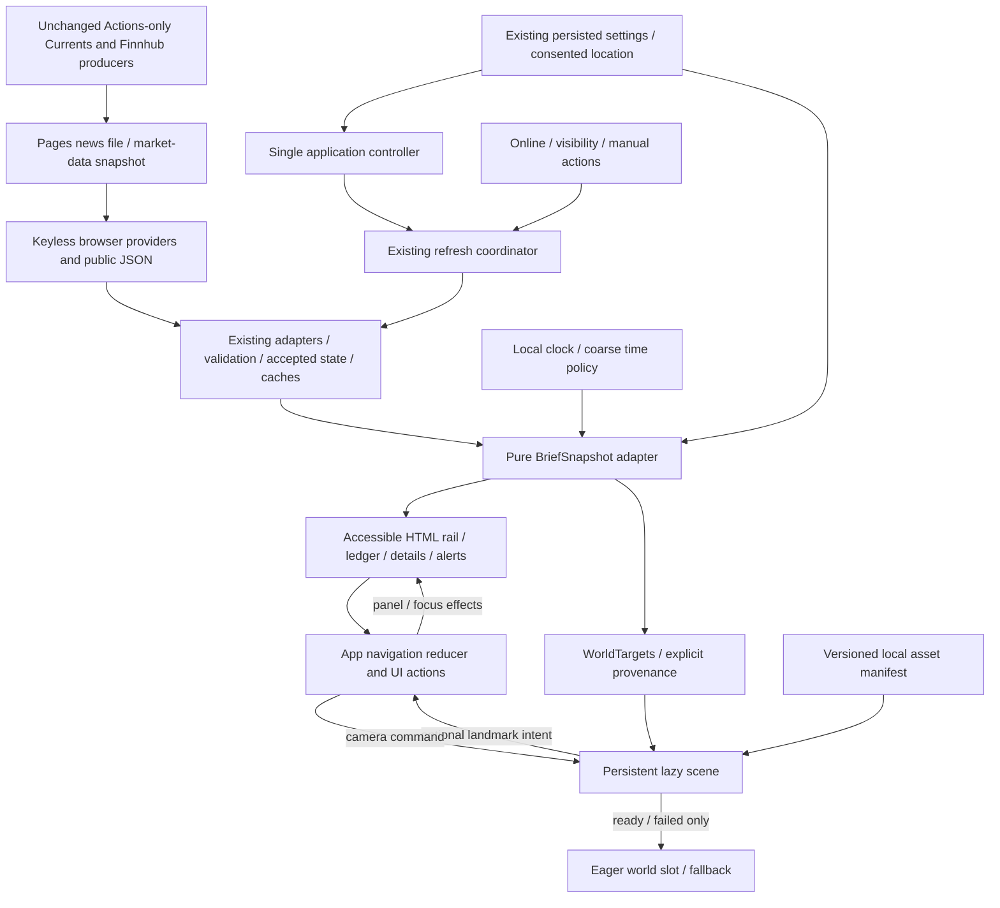
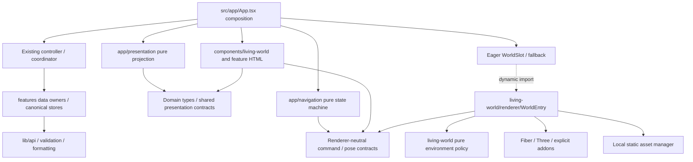
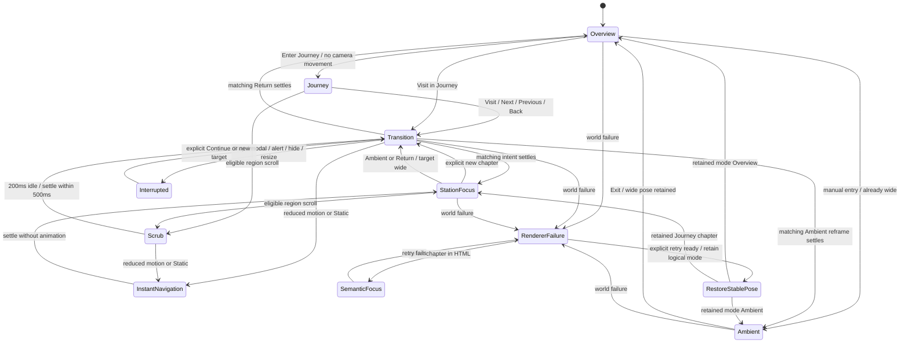

# Living World — technical architecture

Status: **draft for architecture review**, v0.1, 2026-11-02. Decision owner: product owner; technical recommendation: principal frontend/graphics architecture. Approval: **not recorded**. This session authors documentation only. No production features, dependency installation, provider migration or deployment change is authorized by this document.

## 1. Authority, evidence and objective

Integrate one persistent Atlantic-coast island into the existing React application. Keep essential HTML independently usable throughout loading, travel, disabled motion and renderer failure. Preserve all [F01–F16](../docs/current-feature-inventory.md), existing producer pipelines and normalized domain ownership.

Read with [00](00-product-vision.md), [02](02-functional-requirements.md), [04](04-world-and-art-direction.md), [05](05-camera-and-motion.md), [06](06-data-and-interactions.md), [08](08-acceptance-criteria.md), [DESIGN.md](../DESIGN.md), [audit](01-existing-system-audit.md), [data contracts](../docs/data-contracts.md), [performance/accessibility](07-performance-and-accessibility.md) and [roadmap](../plans/implementation-roadmap.md). Engineering/change-control authority remains [AGENTS.md](../AGENTS.md) and the [workflow](../docs/development-workflow.md). New `TA-*` requirements supplement existing IDs. Decisions here are selected recommendations for review, not approval claims.

Research on 2026-11-02: HEAD `887cb004121b975972b81d39bdfb5a2dda7e91a6`, branch `redesign/living-world-v2`; upstream design/product files are pre-existing untracked work. Read all numbered existing specifications and DESIGN.md, inventory, contracts, README and source entry points. Rechecked `App`, controller, coordinator, weather model, atmosphere helpers, compiler/build configuration and installed package versions. The audit's temporary Graphify AST graph was queried, not rebuilt: 637 nodes; query truncated at 40/499 related nodes, used for orientation only. Its known relation-collapse limitation remains; direct source and contracts support the boundaries below. No repository graph, hooks or tooling were added.

### Conflicts and proposed resolutions

| ID | Evidence / conflict | Proposed resolution and consequence |
| --- | --- | --- |
| C01 | Request describes approved specifications; 00/02/04/05/06/08 and DESIGN.md explicitly say draft/pending; no approval reference is present | Use them as the requested design baseline, preserve every requirement, and obtain a dated scope/version approval record before implementation. Do not relabel upstream files approved in this session. Architecture authoring can finish independently. |
| C02 | AGENTS/workflow/specs README say DESIGN.md/specs do not yet exist | Treat these as stale setup statements, not permission to ignore the actual drafts. Propose updating those statements when approval is recorded; keep engineering/security instructions authoritative. |
| C03 | DS-05's nominal world window is 950 px wide at 1366×768; CM-01 reserves the right sheet even when closed, leaving only 542 px | Select the conservative x392–934 lane for camera staging so opening Overview detail never reframes. Keep the 950 px world area behind it. Test landmark sizes/separation and coastline fit early. If impossible, report a design conflict and revise staging/shot requirements through review; do not shrink text or delete OV-02. |
| C04 | DS-05 lists a 104 px weather block and 240 px news block, while OV-02 requires several readings, three headlines and source/age labels | Nominal boxes are flexible, as DS-05 states. Use content-fit tests before locking layout. Reduce optional description/image/world area, then enter DS-08 reflow if necessary. Normal-desktop no-scroll remains an acceptance gate; emergency reflow is continuity, not proof that gate passed. |
| C05 | Existing atmosphere has four time bands, defaults unknown weather to clear, and samples every five minutes; WA-05 requires five bands and neutral unknown, with different daylight windows | Preserve incumbent helpers for rollback; add a pure renderer-neutral five-band policy matching WA-05 and explicit unknown handling. Reuse parsing/formatting only after semantic tests. This is presentation replacement, not a provider rewrite. |
| C06 | EN-02/EN-03 permit optional AQI haze and pavilion change signaling; WA-06 deliberately excludes haze and keeps price change in HTML | Select no AQI haze and no red/green building encoding. The general contracts permit these omissions; retain numeric/category/sign data in HTML. No product capability removed. |
| C07 | PF-03 says ≥30 FPS; PF-05/PF-06 and Static require zero continuous frames | Apply FPS gates to active motion-enabled segments. Still/hidden modes are event-rendered, and are assessed for response latency/zero idle frames instead. This clarifies test domains without weakening either gate. |
| C08 | 08/WA-07 reference Chrome/Safari and Chrome/Edge; request also requires Firefox | Extend the proposed browser matrix to Firefox; retain Edge as supplementary. Browser/device access is a readiness condition, not an assumed pass. |
| C09 | README market cron and “no minute-by-minute browser polling” disagree with YAML/source | Preserve YAML cadence and existing coordinator behavior, record R08/R13. Correct operational prose in a later scoped documentation task; no scheduling change here. |

Open design conflicts C03/C04 need rendered evidence and owner review before full asset/layout production. C01 is an approval-record gap, not a reason to abandon these deliverables. Font binaries, asset rights, hardware access and provider/default-pair compatibility remain unresolved acquisition/operational gates.

## 2. Dependency decisions and compatibility

**TA-01 — Select stable Fiber 9 + Three WebGLRenderer; isolate the graph in a lazy world entry.** Public npm registry metadata was read directly on 2026-11-02 without installation. Installed baseline: React/DOM **19.2.8**, TypeScript **5.8.3**, Vite **6.4.3**, Tailwind **4.3.3**, Zustand **5.0.14**. React's manifest range `^19.0.1` can eventually resolve beyond Fiber's upper peer bound; the lockfile and a fresh peer check are required at the install milestone.

| Candidate / exact version examined | Current relevant peers | Selection / reason |
| --- | --- | --- |
| `@react-three/fiber` **9.8.2** (`latest`) | React `>=19 <19.4`; Three `>=0.156`; React DOM `>=19 <19.4` optional peer, installed here | **Select**. Existing 19.2.8 satisfies peers. Declarative scene ownership fits React, with imperative frame mutation. Reject Fiber 8 (React 18 family) and 10 alpha/canary for launch. |
| `three` **0.187.0** (`latest`) | No peerDependencies or runtime dependencies in inspected metadata | **Select** underlying graphics engine. Use WebGLRenderer, explicit `three/addons` loaders, shared single Three instance. Reject a separate imperative Three application alongside Fiber; both would own lifecycle/camera/rendering. Reject WebGPU requirement. |
| `@types/three` **0.187.0** | No peers; registry has a TS 5.8 dist-tag at this version | **Select dev dependency** matching runtime revision. Preserve `skipLibCheck:false`; TS/Vite compatibility still needs a clean compile, not inferred from peers. |
| `@react-three/drei` **10.7.9** (`latest`) | Fiber `^9.0.0`, React `^19`, React DOM `^19` optional, Three `>=0.159` | **Reject initially**, despite compatible ranges. GLTF/KTX loading, lighting and authored camera paths use Three/Fiber directly. OrbitControls, ScrollControls, Html and automatic camera helpers would conflict with specified ownership. Reconsider only a specific helper with measured benefit. |
| `gsap` **3.15.0**, including ScrollTrigger | No peers/runtime dependencies in inspected metadata | **Reject**. Fixed chapter paths need one cancelable camera clock, not a second ticker. ScrollTrigger's document/scroll timeline model adds ownership and cancellation complexity for a bounded exploration region. No pinned document sequence or full-page scrolling requirement exists. |
| `motion` **14.9.0** | React/DOM `^18.0.0 \|\| ^19.0.0` optional; Remix `^3.1.0` optional; depends on `framer-motion:14.9.0` | **Reject initially**, despite React compatibility. DS-11 sheets/controls use CSS transitions with instant motion-off overrides. No spring/layout choreography justifies another animation runtime. Never install both `motion` and `framer-motion` directly. |

Fiber's Expo, Expo GL/asset/filesystem and React Native peers are optional and outside this browser build; do not install them. Its Zustand `^5.0.3` dependency admits the existing 5.0.14, but `npm ls` must confirm deduplication. Transitive dependencies still count toward bundle budgets. Drei's broad dependency set is an additional maintenance cost, not an assertion that every dependency would be bundled. No router, physics engine, postprocessing framework, sky package, animation package or global state machine library is selected.

Version evidence: [Fiber metadata](https://registry.npmjs.org/@react-three%2Ffiber/9.8.2), [Three metadata](https://registry.npmjs.org/three/0.187.0), [types metadata](https://registry.npmjs.org/@types%2Fthree/0.187.0), [Drei metadata](https://registry.npmjs.org/@react-three%2Fdrei/10.7.9), [GSAP metadata](https://registry.npmjs.org/gsap/3.15.0), [Motion metadata](https://registry.npmjs.org/motion/14.9.0). These are dated observations, not guarantees of future latest tags. Official [Fiber introduction](https://r3f.docs.pmnd.rs/getting-started/introduction) pairs v9 with React 19. Before approved installation, reread exact metadata, use exact renderer/type versions and npm/package-lock, run clean Node-22 checks and a StrictMode browser smoke. Do not upgrade existing React, Vite or TypeScript as incidental renderer work. Peer satisfiability is verified; runtime/build compatibility is **not yet tested**.

## 3. Responsibilities and dependency direction

**TA-02 — One domain composition owner, one persistent canvas, sibling HTML.** Keep `useAmbientBriefController` mounted once above both presentations. No providers/coordinator in Canvas, Suspense, station components, mode branches or failure boundaries. Keep the application ErrorBoundary outside everything; add world-specific isolation inside it. Rendering never imports credentials, producer scripts, request/cache clients or domain loading hooks.

| Boundary | Owner / proposed paths | Inputs → outputs / limits |
| --- | --- | --- |
| 1. Domain services/provider state | Existing `src/features/*` adapters/hooks, `currencyStore`, `prayerTimesStore`, location services | Wire validation/context acceptance/cache → normalized accepted domain state. Integrity work extends owner metadata locally; never provider fields in UI. Existing compatibility re-exports remain. |
| 2. Refresh coordinator | Existing `src/app/refreshCoordinator.ts`, controller | Online/visibility/manual/settings → ordered enabled-domain refresh. Preserve weather→AQI→alerts→prayer→currency→news→markets; address IG-04 deadlines/generations here and request owners. World has no refresh timer or provider refresh API. |
| 3. Presentation adapter | Proposed `src/app/presentation/{contracts,buildBriefSnapshot,deriveWorldTargets}.ts` | Accepted normalized states + context metadata + now/policy → immutable BriefSnapshot and small WorldTargets. Pure, renderer-neutral; no Three, DOM, storage, Fetch or subscriptions. Commands supplied separately by app. |
| 4. World environment state | Proposed `src/features/living-world/{model,environmentPolicy}.ts` | WorldTargets/motion policy → coarse time band, condition/neutral, qualifier, static station signals, quality policy. No duplicated authoritative domain store. Blended uniform values stay in renderer refs. |
| 5. Camera/navigation | Proposed `src/app/navigation/{machine,paths,useWorldNavigation}.ts` | Semantic intent + layout/motion/availability → logical mode/selected/settled/panel and cancelable camera command. Pure reducer + small effect driver; no fetching/persistence/Three in machine. |
| 6. Scene/asset manager | Proposed lazy `src/features/living-world/renderer/` | Targets + camera commands + approved local manifest → one Canvas, scene graph, resource lifetime, capability/failure events. Network limited to declared static assets, never domain endpoints. |
| 7. HTML information layers | Proposed `src/components/living-world/`; existing feature components adapted in place | Same snapshot + app actions → rail, ledger, station detail, alerts, mode controls, fallback, Preferences. HTML owns focus/scroll/links/dialogs; no renderer hooks needed to read values. |
| 8. Preferences/persistence | Existing `src/stores/settings*`, `src/types/settings.ts` | Preserve schema-2 migration and settings key; no new persisted mode, quality, camera, chapter or history. Session-only quality and nav are not preferences. Use Zustand selectors for relevant settings instead of broad frame subscriptions. |
| 9. Fallback/errors | Proposed eager `WorldSlot`, `WorldFallback`, world error boundary; existing app ErrorBoundary | Loading/unavailable/failure → coherent still or DOM plus explicit retry. Renderer subtree may remount; HTML/controller/providers never do. Whole-app fatal recovery remains separate. |

Names above are proposed modules, not present files. Keep related helpers together until a verifiable slice justifies splitting; no new generic plugin/container framework. Strict unions and readonly records follow existing `RefreshProviderId`/`ProviderRefreshResult` style in `src/app/refreshCoordinator.ts` and `DataFreshness` in `src/types/remote.ts`.

### Data flow (arrows carry information or commands)



### Module dependencies (arrows mean imports, never reverse)



**TA-03 — Enforce the boundary.** Later lint/import checks prohibit `renderer/**` from importing `lib/api`, provider modules, domain loading hooks, stores with fetch actions, scripts and controller. Type-only normalized models are allowed. The eager entry/import graph must contain no Three/Fiber imports, including through barrels. Renderer interactions emit typed intents; app maps retry/refresh/settings actions to existing owners. No provider store is recreated inside a scene root.

## 4. Presentation and state contracts

**TA-04 — Preserve identity/provenance at the acceptance boundary.** Do not migrate every provider to unused `RemoteState<T>`. Add metadata beside existing normalized payloads in each owner during IG remediation. Use a small read-only projection for both HTML and world. It cannot repair a payload that lacks context by looking at current settings, or reconstruct timestamps by parsing `lastUpdatedText`.

Contract sketch (documentation, not an installed module):

```ts
type ContextKey = string;
type Availability = 'loading' | 'available' | 'empty' | 'unsupported' | 'disabled' | 'unavailable';
type SourceTime =
  | { kind: 'instant'; iso: string }
  | { kind: 'local'; value: string; timezone: string }
  | { kind: 'date'; value: string }
  | { kind: 'unknown' };

interface PresentedValue<T> {
  readonly value: T | null;
  readonly contextKey: ContextKey;
  readonly availability: Availability;
  readonly freshness: DataFreshness;
  readonly source: string;
  readonly sourceTime: SourceTime;
  readonly successfulFetchAt: string | null;
  readonly lastCheck: { readonly at: string; readonly outcome: 'new' | 'unchanged' | 'cached' | 'partial' | 'failed' } | null;
  readonly origin: 'network' | 'cache' | 'retained' | 'calculated' | 'demo' | 'unknown';
  readonly refreshing: boolean;
  readonly partial: boolean;
  readonly qualifiers: readonly string[];
}
```

`DataFreshness` reuses the existing vocabulary. Clock uses a separate device-time contract. Unavailable/disabled/loading carry null value and `unavailable` freshness; valid-empty uses a typed empty collection with explicit availability. Partial row values remain individually projected. Cache/source delay/reference are retained as secondary qualifiers using DI-04 precedence. ISO fields are accepted validated metadata, not new source promises. Errors have safe domain text separately; `refreshing` never removes a retained value. Unit, pair, schedule date and timezone travel with domain values, not just labels. Global outcome aggregates domain results without replacing row provenance.

Context keys use complete relevant request identity from DI-02. Compare full canonical context even if a historic cache storage key rounds coordinates. A monotonic owner request generation supplements AbortSignal; accept completion only if generation/context still match and clear/disable has not superseded it. This applies to success, fallback, error, loading finalizers and timestamps. Existing fresh/stale windows remain DI-05; validate payloads on read and filter NWS by actual validity continuously. Late arrival cannot repopulate cleared caches. Public feed schemas remain v1. Select **additive internal metadata + conservative unknown source times**, rejecting a producer schema migration for this release.

`BriefSnapshot` groups independently stable weather/forecast/UV/daylight, AQI, alerts, news, market rows, FX and prayer projections. Reuse references when an unrelated domain changes. `WorldTargets` contains only time-band/light parameters, supported condition group or `neutral`, matching provenance/qualifier, accepted alert cue, enabled valid prayer cue, topic selection and effective motion. It contains no URLs for providers, coordinates for fetching, credentials, price tween or observation precision absent from sources. Shared accepted revision IDs allow HTML/world comparison; frames may blend decorations but never interpolate readings.

**TA-05 — Update cadence.** Clock seconds stay inside the clock component. Prayer minute countdown stays in its existing owner after validity fixes. Use one visible, minute-boundary presentation-time tick for age/daylight targets and an exact nearest-alert-expiry timer for ≤1 s filtering; resume reconciles before displaying retained alerts. These timers do not poll providers. Environment target updates occur on accepted domain/context, material local-time boundary and policy changes. No second tick through App/world store. React commits occur for semantic changes, not frames. GPU camera transforms, interpolation progress, particle buffers, wind/water uniforms and runtime metrics stay in refs/local typed buffers. No frame-rate Zustand `set` or React `setState`.

## 5. Island rendering, assets and lifetime

**TA-06 — Select modeled terrain and modular GLB assets.** One authored terrain/shoreline/path composition, four separately named landmark roots, shared props/materials and semantic anchors follow WA-01. Reject runtime procedural terrain generation: authored camera corridors, connected paths and repeatable silhouettes matter more than random detail. Deterministically seeded prop placement is allowed offline; procedural runtime water/sky/particles are small bounded effects. No physics/collision engine; use exported coarse collision envelopes for camera authoring/testing. Graybox is private feasibility evidence only, not final WA art acceptance.

**TA-07 — Select glTF 2.0/GLB**, with bounded standard/low exports, static PBR base materials and explicit loader extensions. Keep base island/low versions of all four landmarks resident once ready; selecting a chapter never downloads its essential building. Optional near-detail is background idle work, not a navigation gate. No four independent canvases or mode scene rebuilds. Instanced static rocks/vegetation reuse geometry/materials; no per-tree React state. Near detail is P2 unless required for reviewed P1 silhouette/finish.

**Ocean:** a bounded low-poly surface around the island with broad vertex waves and a static authored shoreline foam mask. No FFT, reflection camera, screen-space reflections/refractions, volumetric water or physics. A small authored shader is justified for this single signature surface; a standard flat material is its low/failure alternative. Disable wave time under motion-off. Shore contact and static color variation preserve identity without high-frequency specular noise.

**Sky/lighting:** world-only color gradient dome, simple sparse cloud geometry/atlas, broad hemisphere fill and one directional key; restrained ACES tone mapping initially, tuned against WA palette. No remote HDRI, atmospheric scattering framework, volumetric clouds, bloom, SSAO or depth-of-field in launch. Use a small local prefiltered environment map only if reviewed glazing cannot read without it, within budgets. One bounded shadow map on standard tier (initial 1024² proposal); baked/vertex contact shading on low. Update shadows on material lighting changes rather than every wave/particle frame; decorative movers do not cast them. HTML colors/backings never pass through world tone mapping.

**Weather:** one pooled instanced streak/point system, deterministic seed, existing normalized grouping, no object allocation per particle/frame. Standard ≤120 rain or ≤80 snow, low ≤40/24, never both; no lightning, screen droplets, accumulation, forecast-triggered precipitation or AQI haze. Fog is bounded scene depth fog preserving silhouettes, not a visibility measurement. Condition blending is two seconds; immediately neutralize invalid old-context cues before blending newly accepted weather. Static/reduced has zero moving particles, water, vegetation or cloud drift. Subtle halves amplitude and doubles loop durations.

**TA-08 — Asset manager is only for declared static assets.** An eager lightweight manifest identifies ID/version/hash, URL, byte estimate, critical/optional class, low counterpart and attribution key; Three imports live only inside its lazy implementation. Use Three `LoadingManager`, `GLTFLoader`, `KTX2Loader` and a manifest-scoped promise map. Prefer uncompressed/quantized geometry initially; add Meshopt only when size measurements justify its one decoder. Reject simultaneous Draco and Meshopt. Select KTX2/Basis textures for final atlas workflow, subject to verified encoder/transcoder availability; keep an ordinary low PNG/JPEG GLB variant for incompatible decoding. Plain low assets still satisfy resource budgets; no decoder failure loop.

Load sequence: usable HTML → local still if available → deferred code → single context/capability setup → critical low island/assets → decode/upload/compile → first complete overview → optional standard tier only within limits. World-ready means all four landmarks, terrain, water/sky and usable materials have actually rendered, not just resolved downloads. Do not announce ready on an empty canvas. Keep still visible until that signal. Progress is based on manifest tasks/known bytes and says indeterminate if length unknown, never fake percentages.

Promise lifecycle is scoped to a renderer attempt ID. Static assets may use ordinary HTTP caching, not the domain localStorage cache. Cancel owned fetches where possible; Three loaders/decode may not abort completely. Ignore obsolete completions and dispose their results. No process-global unbounded `useLoader` cache. Resource manager owns textures/materials/geometries/targets/decoder workers; scene owns references. Shared resources are disposed once when the attempt ends, never when a single station hides. Explicitly dispose primitive-loaded GLTF resources (not guaranteed by automatic JSX disposal), close uniquely owned ImageBitmaps after use/disposal, terminate workers, clear promise entries and remove listeners/timers. StrictMode setup/cleanup/restart must be idempotent. No dispose of a texture still shared by another live object.

Use demand rendering at rest. Active camera travel/environment blending requests the next Fiber frame; no independent GSAP/Three render loop. Settled Living/Subtle uses one visibility-gated pacing timer to request approximately 30 decorative frames/s through Fiber invalidation; it does not call `render` or publish app state. Stop that timer during travel (Fiber frame invalidation owns pacing), motion-off, hidden, modal suspension or failure. A single invalidation draws changed still targets. Never run both a self-invalidating resting loop and the pacing timer. Exact pacing/frame results must pass PA tests; there is no claim that this strategy meets budgets yet. [Fiber's demand rendering](https://r3f.docs.pmnd.rs/advanced/scaling-performance) supports invalidation; [performance pitfalls](https://r3f.docs.pmnd.rs/advanced/pitfalls) explains frame mutation.

### Reproducible asset workflow — TA-09

1. **Acquire rights before integration.** Commission terrain/four landmark silhouettes or obtain one style-compatible kit; preserve editable source/version. Ledger records asset ID, source/author/date, exact license and proof, permission to modify and redistribute downloadable GLBs/textures, attribution text/location, reviewer and hash. Unclear rights block that asset; concepts are not licensed production geometry. Fonts have their own ledger and exact WOFF2/license files.
2. **Verify tools, then pin them.** On this host, Node 26.13.0/npm 11.20.0 exist; `blender`, `gltf-transform`, `gltf-validator`, `toktx`, `ktx`, `basisu` were not on PATH; `/Applications/Blender.app` is absent. No public GLB/glTF/KTX2/WOFF2 was found. This is not proof no tool exists elsewhere. Future M09 verifies binaries/version/license, or commissions reproducible exports externally. Do not silently run `npx latest` or install tools in this session. Review/pin dev-only optimizer/validator versions and encoder binary provenance separately from runtime packages.
3. **Author/import consistently.** glTF meters/+Y up, WA +X east/+Z south, local ground origins, sea Y=0; freeze transforms, named roots/anchors/collision envelopes, no auto-playing exported cameras/lights, no accidental embedded remote textures. Keep source models outside runtime payload; source manifest records their location and digest. Use approved shared bevel/UV/material scale.
4. **Optimize deterministically.** Export canonical GLB; deduplicate/weld/prune safely, quantize and instance repeat props without removing station anchors. Produce standard ≤180k visible scene triangles and low ≤90k variants. Use measured LOD only where distance saves enough draw/vertex cost; one low→standard switch with hysteresis, never silhouette popping. Load all necessary low geometry first. Test ≤2 CSS px silhouette shift at each authored view; Static changes only on explicit render updates.
5. **Compress textures.** Atlas 512–1K low, 1K shared/≤2K hero standard; no default 4K. Base-color/emissive sRGB, normal/ORM linear; mipmaps accounted for. Prefer ETC1S for forgiving base/ORM, UASTC for normals/critical edges when visual review justifies bytes. Encoder settings/version/commands and output hashes are ledger fields. KTX2 transcodes to device-supported compression via `detectSupport(renderer)`; unsupported WASM/format uses plain low variant or still, never assumes ASTC everywhere. [KTX2Loader](https://threejs.org/docs/pages/KTX2Loader.html), [glTF Transform CLI](https://gltf-transform.dev/cli).
6. **Validate and inspect.** Run pinned [Khronos glTF Validator](https://github.com/KhronosGroup/glTF-Validator) before/after optimization. Zero errors; warnings individually reviewed in report, no blanket suppression. Check required extensions against chosen loader. Exported report lists bytes, nodes/primitives/materials, unique and rendered triangles, textures/mips and decoded estimates. Render day/night/all six shots; inspect normals, UV seams, transparency, sea contact and silhouettes in all target engines. Store recipe, validator JSON, visual evidence and exact tools with asset version.
7. **Publish local immutable runtime assets.** Proposed `public/world/v1/` for models/textures/decoder files/stills and `src/features/living-world/assets/manifest.ts` for typed references. Every path is relative to `import.meta.env.BASE_URL`; e.g. `${import.meta.env.BASE_URL}world/v1/island-low.glb`. Never `/world/...`, CDN default decoder URLs, or arbitrary user URLs. Alternatively imported small assets use Vite `?url`; do not mix path conventions. Verify `/`, `/ambient-brief/` and a custom base. Nested model resources stay within their version directory. Hash filenames on content change; retain old immutable resources during an asset rollout where hosting permits. No publishing/deployment workflow rewrite is required. [Vite asset handling](https://v6.vite.dev/guide/assets).
8. **Generate fallbacks and attribution.** Render approved geometry into local day/night overview plates ≤350 KiB each; station crops optional. A still failure falls back to tokenized DOM, never blocks data. Same identity/rights review as models; generated concepts are not automatically accepted plates. Attribution accessible in Data & Privacy with license/source ledger references. Release inventory checks every runtime file/embedded texture/font has a ledger entry; runtime requests must be same-origin except preserved data/news-image integrations.

## 6. Implementable camera/navigation machine

**TA-10 — A pure event reducer controls intent; one renderer driver controls pose.** Separate logical mode (`overview|journey|ambient`), selected target, last settled chapter, open detail, completed visit stack, modal depth and renderer status. No frame position in reducer/Zustand. Session-local state starts Overview and does not touch URL or storage. A bounded previous-visit stack (proposed 32 completed visits, oldest dropped) prevents unbounded memory; record this new limit for review. Previous/Next use fixed chapter order, not this stack.

Camera activity is a discriminated union: `rest`, `transition {intentId,target,origin,reason,duration}`, `scrub {intentId,from,to,direction}`, `interrupted {intentId,target,cause}`, `instant {intentId,target}`, `unavailable {reason}`. `origin` is direct/scroll/mode/continue and controls focus effects. Last actual pose/progress lives in the driver; reducer needs only a pose handle for replacement/holding. A failed renderer can coexist with any logical mode and semantic station focus. Reduced motion is a policy/instant branch, never a fourth experience mode.



Diagram is a camera/view projection, not a second mode store. Retry chooses the retained mode/settled chapter's stable pose, or the selected target if explicitly selected in fallback; it never resets the logical mode. Journey at its initial overview vantage also restores that wide pose. The transition table is authoritative for orthogonal suspension and focus.

| State/event | State/effects | Focus, panels and history |
| --- | --- | --- |
| Startup | Overview + rest overview; load world independently | No startup focus move; summary/placeholders immediately. |
| Overview `DETAIL(station)` | Select/open that detail; camera stays constant | Focus heading for keyboard/tap; close restores invoker. No visit entry. |
| `ENTER_JOURNEY` from Overview | Journey, settled overview vantage; rest | Focus exploration heading/navigation; no implicit trip. |
| Journey `VISIT/NEXT/PREVIOUS` or explicit `VISIT_IN_JOURNEY` | Select target immediately, keep last settled sheet named accurately, create one transition intent | Show travelling + Stop; direct completion focuses target heading once. In Journey landmark click means direct visit, in Overview/Ambient it means Details; HTML mirrors both. |
| `DETAIL` during travel | Open requested local sheet without changing camera target; mark it explicitly as local detail | Settlement never replaces a newer manually opened detail or steals its focus; user interaction increments focus/panel generation. Details remain independent of settled chapter. |
| matching `SETTLED(intentId)` | Snap exact authored endpoint once; update settled chapter; end transition; push completed station visit unless Back/Return | Default sheet becomes destination only if panel generation still matches intent; direct heading focus only if focus epoch still matches and no modal/hidden state. Scroll origin announces once and retains focus. |
| newer navigation while moving | Invalidate old ID/settle timer; sample current pose and start new safe corridor; no queued trip | Latest target label immediate, last settled data retained. Never accept stale completion. |
| `STOP` or Escape after nested UI is closed | Interrupted held current pose within 100 ms; save target and last settled chapter | Keep current focus and accurate panel label; Continue/Return available. Never record interrupted pose as completed visit. |
| `CONTINUE` | New intent ID from held pose to target | Explicit action only, matching settlement behavior. No old timeline resurrection. |
| `OPEN_MODAL`, new critical alert, `HIDE`, resize/reflow | Cancel current driver/scroll timer and hold; maintain selected/settled/mode; gates suppress world inputs | Modal traps/restores focus; alert announces once without focus theft. Hide/resize never move focus. Close/show clears gate but does not auto-resume. |
| motion reduction/Static during motion | Cancel intent/timers ≤100 ms; instant selected destination, record one valid settlement | Suppress focus effect if modal or newer focus epoch; still all chapters usable. Re-enable waits for next deliberate navigation. |
| `RETURN_OVERVIEW` / final chapter | Set overview target, cancel prior intent, close detail and clear visits; move by bounded reframe or instant | Focus Overview on settlement, never through an open modal. Ambient entry similarly sets mode immediately/target wide; settles focusing Exit. Ambient Exit returns Overview without Journey replay. |
| Journey `BACK` | Pop current completed visit and target prior completed visit; Overview if absent | Do not push the destination again on Back settlement. Suppress duplicate consecutive entries. Browser Back is untouched. |
| `RENDERER_FAILED` | Cancel, unavailable camera; retain logical mode/selected/settled/detail; show still/DOM | Keep HTML focus unless its focused element vanished, then same station button or Overview. All HTML chapters now settle instantly. Retry ready restores current stable logical pose, not interrupted travel. |

Every intent carries monotonic ID, input origin, focus epoch and panel generation. Cancellation increments ID, clears scroll settle timers, stops camera driver and removes its completion handler. Completion rechecks all IDs, gates and mounted ownership. Promise cancellation alone is insufficient. Modal close releases navigation but never resumes. Alert pause does not end Ambient/Journey. Renderer failure has highest camera priority; then hidden/modal gates; then motion policy; then latest explicit input. A mode request behind a modal must wait until it closes; inert background cannot issue it.

Paths use reviewed WA/CM anchors and dimensionless smoothstep progress; camera position along clear-water cubic corridors, look target interpolated with stable up vector/quaternion and zero roll. Durations: adjacent 1.2 s, nonadjacent/return 1.6 s, short retarget 0.8 s; hard cap 2 s. All ten unordered station/Overview pairs need forward/reverse review, plus midpath egress tests at 5% samples; 3 m architecture/terrain and 5 m crown margins. New target begins at actual current pose, with velocity-aware easing and no snap/whip. If a safe egress cannot meet duration/continuity, hold with working HTML and record failed camera acceptance; obtain reviewed staging/path correction instead of inventing a longer flight. Final corridor control points are asset-dependent, not solved by the candidate coordinates alone.

### Scroll/input ownership — TA-11

Only a desktop, motion-enabled Journey exploration region consumes eligible wheel/pan. No root/document wheel handler, pinning or OrbitControls. Bind a local non-passive wheel handler only while it can consume camera progress. Ignore Ctrl-wheel/pinch, predominantly horizontal wheel, typing/native controls, panel/modal targets, nonprimary pointer and text-selection gestures. Normalize deltaMode (pixels directly, lines using measured line height, pages using region height); accumulate 480 CSS px per adjacent segment and clamp within it. Touch uses Pointer Events with capture/cancel and `touch-action` only on this explicit region; narrow layouts retain native pan/zoom and direct controls. A >8 CSS px pointer movement cancels landmark click (proposed threshold, test touch precision); pointercancel always releases ownership. Tab always exits.

After 200 ms with no input choose nearest segment endpoint (tie follows direction); complete in ≤500 ms. One gesture session cannot queue multiple segments. Opposite input reverses the current segment; new input during settle cancels/re-scrubs from current progress. Stop/modal/hide/failure/nav/reduction cancels pending settle. Motion-off region does not animate: same accumulated threshold/release decision selects still endpoint; buttons provide the complete alternative. At reflow/fallback, remove camera gesture consumption entirely and let document scroll; semantic chapters still work. Local panels use normal scrolling with contained overscroll so panel-edge input cannot reach exploration. Browser zoom/selection and native keys are never canceled globally.

Focus order, nested Escape priority and one-time announcements follow IN-03/IN-06; DOM focus remains in HTML. Detail is nonmodal on desktop, Preferences/official-alert/provider dialogs retain modal roles/traps. Navigation group Arrow/Home/End is scoped; no new document shortcuts. Closing details restores its surviving invoker. Refresh updates do not scroll content or reset selected topic. No `pushState`, `replaceState`, hash changes or popstate interception; reload starts Overview.

## 7. Failure isolation and recovery

**TA-12 — World failure is never domain failure.** WorldSlot owns lightweight `deferred|loading|ready|failed|retrying|still` state. Suspense/error boundaries surround only world code/assets, not summaries/settings/coordinator. Canvas fallback handles initial context absence; bridge explicit errors from assets, asynchronous compilation and WebGL events into WorldSlot. React boundaries alone do not catch those. Production message is safe/concise; technical details remain local development diagnostics without keys/coordinates/third-party telemetry.

| Condition | Detection and action | Recovery / essential HTML |
| --- | --- | --- |
| WebGL 2 absent/blocked/software caveat | Attempt bounded context creation in world setup, catch creation error; inspect capabilities, not UA. Do not create an extra permanent probe context. Three requires WebGL 2 | Local still/DOM, reason + Retry world. WebGL 1/WebGPU-only fallback renderer is not built. All data/control paths independent. |
| Context loss | `webglcontextlost` listener prevents default, marks failed, stops timers/driver and abandons GPU ownership ≤1 s | Keep still and explicit retry. A `webglcontextrestored` event does not restart travel/render loop automatically. Retry replaces only renderer attempt after disposal, using low tier; repeated failure stays fallback. |
| Critical model/texture missing or invalid | Manifest loader rejection, validator incompatibility, decode failure or startup deadline | Complete overview required: do not publish half-island as ready. If optional detail fails, keep reviewed low geometry with concise reduced-detail status. Critical failure shows still; no repeated asset fetch. |
| Custom shader compilation/link failure | Enable shader checks at startup; `renderer.debug.onShaderError` and guarded compile/render; do not rely on a thrown exception alone | For optional ocean/effect, use prevalidated plain material once. Essential material/driver failure enters world fallback. Check every reachable time/weather variant before ready. |
| JS dynamic chunk failure / stale deployment | Catch dynamic import rejection and isolated boundary; Vite preload failure listener handles only world import context | HTML remains. Retry uses a new attempt/lazy wrapper and one import attempt. Browsers may cache failed module evaluation: disclose failure and offer explicit Reload page if needed; never reload automatically or fabricate cache-busting chunk URLs. Settings chunk has its own loading/error/retry HTML. |
| Low memory / resource pressure | Cap inventory before allocations; failed allocation/context loss and sustained poor frame time signal pressure. `deviceMemory` optional hint only | Start low when uncertain, downgrade session-only, release unused standard assets. At hard cap/repeated loss select still. No unsupported universal VRAM/low-memory detector promise. A browser-killed process cannot be caught; next load starts HTML/Overview. |
| Disabled motion | OS OR app OR Static policy, checked initially and on change | Still 3D demand render, or authored still; instant chapter selection, zero continuous effects; no error label. No-motion alone does not remove semantic Journey/Ambient. |
| Slow/offline network | Visible bounded loading; no eager renderer on Save-Data when available; asset attempt 15 s deadline, independent of provider sweep | Still remains, “World taking longer” + Retry after timeout; abort/ignore obsolete assets. Missing still uses DOM. No automatic retry/download loop. Provider results continue. Six-second world-ready performance target is stricter than this 15 s recovery ceiling. |

First failure stops current attempt immediately; fallback visible ≤1 s after detected failure. On explicit Retry: increment attempt ID, release owned resources/listeners/workers/promise cache, retry known local manifest at low tier, keep HTML and focus. Never reset settings/caches/coordinator. Successful retry restores stable current pose with no fly-in. Twenty retry cycles must not accumulate resources. [Three WebGLRenderer](https://threejs.org/docs/pages/WebGLRenderer.html), [GLTFLoader](https://threejs.org/docs/pages/GLTFLoader.html) and [WEBGL_lose_context](https://developer.mozilla.org/en-US/docs/Web/API/WEBGL_lose_context) inform these mechanisms; failure policy is the project's design recommendation.

## 8. Verification, migration gates and review history

Technical acceptance: TA-01 → M07 peer/compile/StrictMode; TA-02–TA-05 → M01–M06 context/projection/import/request-count tests; TA-06–TA-09 → M08–M10 asset/staging/performance evidence; TA-10/TA-11 → M11–M13 state-machine/cancellation/path/input/focus traces; TA-12 → M07/M14 failure and retry tests. Exact milestone contracts and all F/R mappings are in the roadmap; numeric methods in 07. Existing AC/VA requirements remain binding and unexecuted for Living World.

All meaningful implementation slices require tests, zero-warning lint, typecheck and build, plus relevant browser evidence. No installation, app source, lockfile, workflows or public feed changes in this documentation session. Approval/change history: 2026-11-02 v0.1 proposed; peer metadata verified, runtime renderer compatibility/performance/assets **not tested**. Full evidence/status is in [progress](../plans/progress.md).

## Architecture decision record — ADR-LW-01

**Status:** Proposed, pending recorded review. **Date:** 2026-11-02. **Decision:** Integrate stable Fiber 9.8.2/Three 0.187.0 as a deferred, persistent WebGL 2 presentation sibling to accessible HTML. Preserve current domain/refresh/producer boundaries; add renderer-neutral accepted-state projection, cancelable local navigation reducer and isolated static/DOM recovery. Use authored GLB terrain/landmarks, restrained procedural sea/sky/particles, explicit static asset management and existing CSS for 2D transitions.

**Alternatives rejected:** a rebuilt data stack (unnecessary/security regression); direct Three app beside React (duplicate lifecycle owner); Fiber prerelease/WebGPU requirement (compatibility risk); Drei/GSAP/ScrollTrigger/Motion at launch (unneeded responsibilities); runtime procedural terrain (unrepeatable composition); all-static launch (valid fallback but fails mandatory P1 island); multi-canvas scenes (resource/lifecycle cost and breaks one-place continuity).

**Consequences:** GPU assets and camera paths require measured staging, rights/provenance and disposal engineering; current hook metadata needs scoped integrity corrections before scenery dependence. HTML remains useful if any renderer path fails. Exact selected versions require install-time recheck and clean compile; draft budgets and art/camera constraints need review. Owner records approval or a superseding ADR here before dependency implementation; no silent architecture/budget changes.

## Implementation readiness checklist

- [x] Architecture recommendation, dependency evidence, data/module diagrams and nine ownership boundaries written.
- [x] Implementable navigation/cancellation/input/history and failure/resource policies specified.
- [x] F01–F16, R01–R13, budgets and incremental verification mapped in companion documents.
- [ ] Record product/design/architecture/performance approval scope/version and resolve C01–C04 as applicable.
- [ ] Confirm named hardware and Chrome/Firefox/Safari access; record supported version policy and actual test versions.
- [ ] Approve integrity remediation contracts; pass IG-01–IG-04 and DI-08/DI-09 before data-derived scene acceptance.
- [ ] Recheck peers and prove exact package set with Node-22 clean build/StrictMode test before full renderer work.
- [ ] Prove 1366×768 safe-lane geometry, all-pair/interrupt corridors and vertical slice budgets before full asset migration.
- [ ] Appoint asset/license owner, verify toolchain, export recipes and approved fallback/font assets.
- [ ] Resolve operational/default-pair/CORS/entitlement gates or obtain explicit reviewed scope resolution.
- [ ] Execute future acceptance, visual/accessibility, failure/retry and eight-hour evidence; none is implied by this architecture.

## Scoped integrity implementation approval — 2026-11-02

The product owner's chat request, “Implement the approved high-priority data-integrity remediation milestone for Ambient Brief 2.0,” authorizes R01–R04 and R09 only where required for cache correctness. This records approval of IG-01–IG-04, the TA-04 acceptance/projection boundary, and the direct15s/shared30s request ceilings for this milestone. It does not approve renderer dependencies, island work, dashboard migration, new providers, public producer schemas or deployment changes. The broader architecture/design review gates above remain open. Implementation and evidence: [integrity milestone](../plans/data-integrity-remediation.md).

## Scoped observatory prototype approval — 2026-11-02

The product owner's subsequent request, “Implement the first approved Living World vertical slice,” authorizes the selected Fiber 9.8.2 / Three 0.187.0 / types 0.187.0 architecture for an isolated island/observatory prototype. The explicit no-migration/no-extra-landmarks/no-domain-integrations boundary narrows M08's earlier four-landmark/data-driven milestone. Original geometry is authored offline in a versioned source recipe and exported with the selected Three GLTFExporter; runtime consumes a fixed GLB. No runtime procedural terrain or remote asset is introduced. Daylight is a labeled art study, without a weather/time-to-scene adapter.

This approval permits the development entry and explicit local preview flag, renderer isolation, accessible camera controls and fallback/performance verification. It does not approve production rollout, all-mode HTML migration, complete four-station art, new provider ownership or relaxed budgets. C03/C04's full summary/sheet feasibility and reference A/B release gates remain open. [Implementation and evidence](../plans/living-world-first-slice.md).
